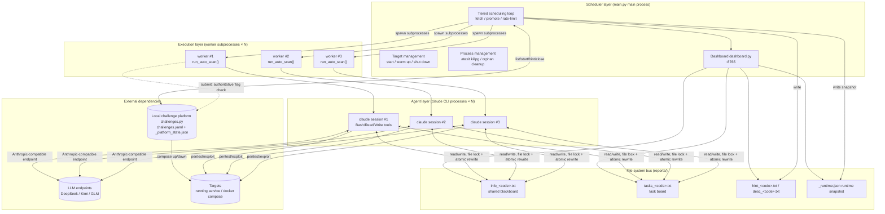
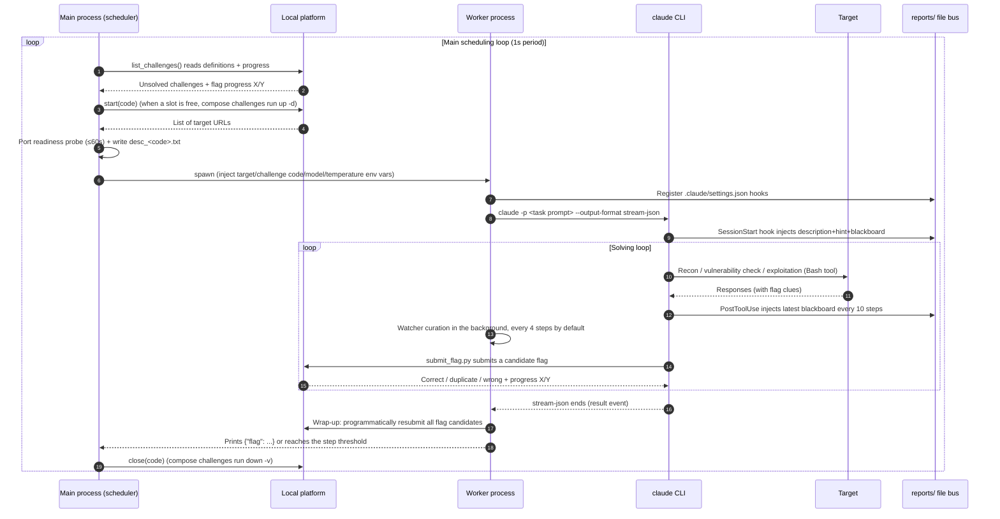
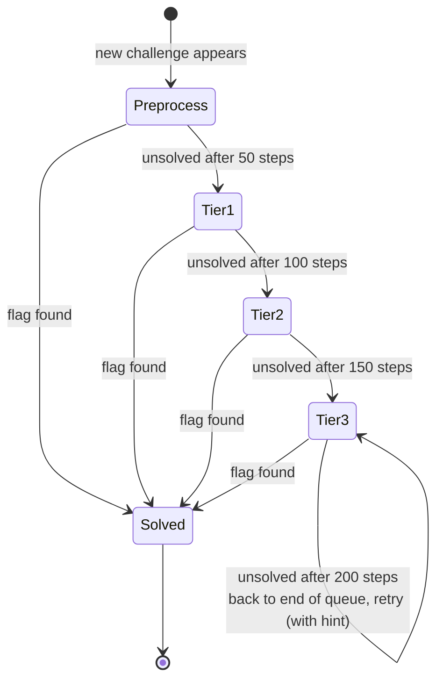
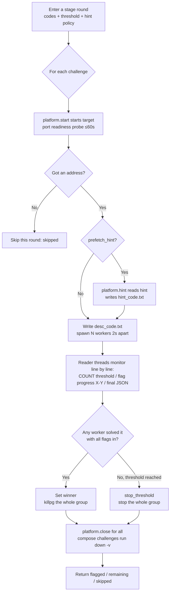
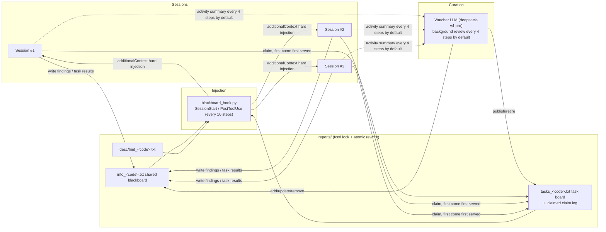
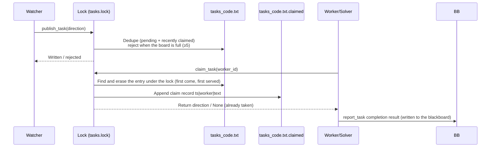
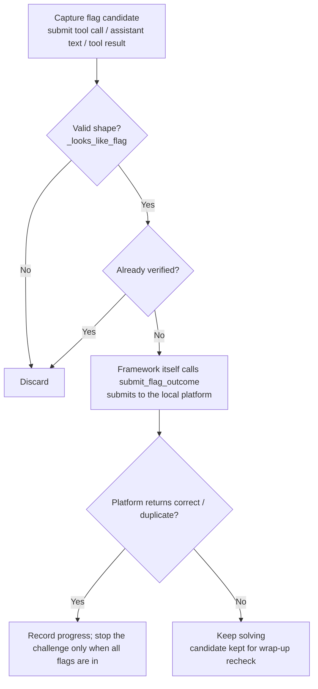
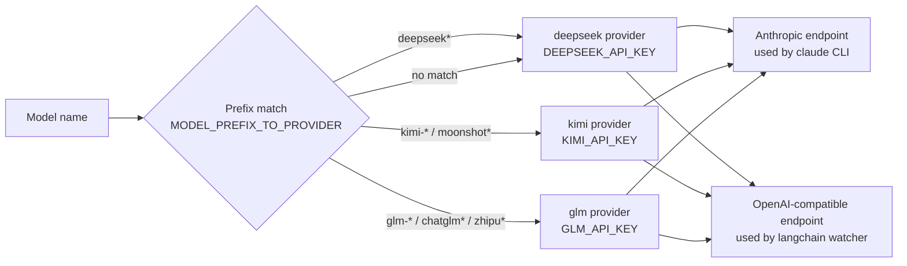

# Cruiser Technical Design

> An automated agent for finding and exploiting CTF Web/logic vulnerabilities, running entirely on the local machine


| Item | Details |
|------|---------|
| Document version | v1.2 |
| Document date | 2026-10-29 |
| Code baseline | Cruiser main branch (`main.py` + the `cruiser/` package) |
| Audience | Security researchers, agent-system developers, people running their own CTF challenge sets |

---

## Contents

1. [Overview](#1-overview)
2. [Overall architecture](#2-overall-architecture)
3. [Core subsystem design](#3-core-subsystem-design)
4. [Tiered scheduling](#4-tiered-scheduling)
5. [Multi-session collaboration](#5-multi-session-collaboration)
6. [Authoritative flag verification and multi-flag handling](#6-authoritative-flag-verification-and-multi-flag-handling)
7. [LLM access and multi-model routing](#7-llm-access-and-multi-model-routing)
8. [Local challenge platform](#8-local-challenge-platform)
9. [Challenge definition format (YAML)](#9-challenge-definition-format-yaml)
10. [Toolchain and offline knowledge base](#10-toolchain-and-offline-knowledge-base)
11. [Configuration](#11-configuration)
12. [Concurrency safety and fault tolerance](#12-concurrency-safety-and-fault-tolerance)
13. [Observability](#13-observability)
14. [Deployment and operation](#14-deployment-and-operation)
15. [Performance tuning](#15-performance-tuning)
16. [Risks and limitations](#16-risks-and-limitations)
17. [Future directions](#17-future-directions)
18. [Appendix](#18-appendix)

---

## 1. Overview

### 1.1 Background

A CTF (Capture The Flag) challenge usually takes the form of "one target service + one or more flags". Cruiser keeps challenges, targets, and answers together in a local YAML file (`challenges.yaml`): a target can be an already-running service or a docker compose project started on demand. The agent connects directly to the target address to find and exploit vulnerabilities, and hands any flag it gets to the local platform for verification.

Solving by hand cannot keep up with the throughput a batch of challenges needs, so Cruiser's design goal is: **complete the full loop of "read challenge → start target → drive the agent to solve → verify the flag → shut down the target" fully automatically**, and maximize solving throughput and success rate within the local concurrency limit through multi-process concurrency, tiered scheduling, and memory shared across sessions. The whole flow depends on no external competition platform, credentials, or VPN.

### 1.2 Design goals

| Goal | Description | Mechanism |
|------|-------------|-----------|
| Fully automatic loop | Runs through the whole challenge set without human intervention | Main-process scheduling loop + local challenge platform (`cruiser/challenges.py`) |
| High throughput | Concurrency slots (default 3) are always full | Tiered scheduling + dynamic parallelism |
| High success rate | Hard challenges get multiple rounds and multiple viewpoints | Four-tier promotion + blackboard shared across sessions + hints enabled by tier |
| Crash recovery | Death of a process at any layer does not affect the whole system | Three-layer process boundaries + process-group reaping + orphan cleanup fallback |
| Trustworthy results | Flags must be verified by the local platform against the challenge definition; the model's own claims are not trusted | Authoritative framework verification + programmatic resubmission |
| Solving discipline | No web search, minimal reliance on hints | WebSearch/WebFetch disabled + hints delayed until tier 3 |

### 1.3 Design principles

1. **Clear process boundaries**: the scheduler, execution, and agent layers each have their own job, and a crash in one layer can be recovered independently.
2. **The file system is the bus**: cross-process collaboration introduces no message queue or database; everything goes through text files under `reports/`, made concurrency-safe with `fcntl` file locks plus atomic rewrites via a temp file and `os.replace`.
3. **Do not trust the model's own claims**: flag validity and progress are judged solely by the local platform's verification results (`reports/_platform_state.json`).
4. **Hard context injection**: key collaboration information (challenge description/hint/blackboard) is injected directly into the model context through Claude Code hooks, without relying on the model choosing to read files.
5. **Table-driven extensibility**: LLM providers are wired in through a registry + model-name prefix routing; adding a provider takes only two lines of configuration.

### 1.4 Terminology

| Term | Meaning |
|------|---------|
| Challenge | One CTF challenge in the challenge definition file, with a unique `code`; it may contain several flags |
| Session | One complete `claude` CLI solving conversation |
| Worker | An execution-layer subprocess (a copy of `main.py --sessions 1`); each worker launches one claude session |
| Solver | A directed worker: it claims a single exploration direction from the task board and focuses on executing it |
| Watcher | Background curation LLM: reviews session activity, maintains blackboard quality, publishes exploration directions |
| Blackboard | The file of key facts shared across sessions, `reports/info_<code>.txt` |
| Task board | The file of exploration directions waiting to be claimed, `reports/tasks_<code>.txt` |
| `[COUNT]` | The step count printed by a worker (+1 per assistant event); the scheduler uses it to judge tier thresholds |
| turn | The claude CLI turn count (`--max-turns`); measured differently from `[COUNT]`, which is roughly several times larger |

---

## 2. Overall architecture

### 2.1 Three-layer process architecture

Cruiser's solving engine drives an autonomous agent through the [`claude` CLI](https://docs.anthropic.com/en/docs/claude-code) (in `--output-format stream-json` streaming mode); the Anthropic-compatible endpoint defaults to DeepSeek. The system has three process layers:



Process chain:

```
main.py (scheduler) → main.py --sessions 1 (worker) → claude CLI → bash/python tool subprocesses
```

Responsibilities and crash isolation per layer:

| Layer | Process | Responsibility | Crash blast radius |
|-------|---------|----------------|--------------------|
| Scheduler layer | `main.py` main process | The only process that manages target lifecycles: polls unsolved challenges, schedules by tier, spawns workers, monitors `[COUNT]` step counts, shuts down targets and reaps orphan processes, serves the dashboard | Global exit; `atexit` cleans up all workers as a group and brings down the `cruiser_*` compose projects |
| Execution layer | Worker subprocess (with `CRUISER_WORKER_ID`) | Calls `run_auto_scan()`, launches claude and parses its streaming output, triggers the watcher, verifies flags authoritatively | One session of one challenge fails; other challenges are unaffected |
| Agent layer | `claude` CLI process | The actual solving agent, using built-in Bash/Read/Write tools for reconnaissance and exploitation | The session ends; after the worker wraps up, a new session can be started |

### 2.2 End-to-end data flow



### 2.3 Key technology choices

| Area | Choice | Rationale |
|------|--------|-----------|
| Agent runtime | `claude` CLI (stream-json headless mode) | Mature tool-call loop, context compaction, and hook mechanism; avoids the reliability problems of a home-grown ReAct loop |
| Solving model | DeepSeek (default `deepseek-v4-flash`) | Wired in through the Anthropic-compatible endpoint, 1M context window |
| Curation model | `deepseek-v4-pro` | Blackboard curation and direction planning need stronger reasoning |
| Inter-process communication | File system + `fcntl` locks + `os.replace` | No external dependencies, good crash consistency, human-inspectable |
| Challenge platform | Local YAML + `fcntl` state file (`cruiser/challenges.py`) | No external dependencies; challenges/targets/answers can be version-controlled; same file-bus concurrency model as the blackboard |
| Package management | uv + `pyproject.toml` | Fast and lockable (`uv.lock`); offline images ship the whole virtual environment |

---

## 3. Core subsystem design

### 3.1 Project layout

```
Cruiser/
├── main.py                  # CLI entry: challenge scheduling, multi-session concurrency, tiered scheduling, target/process management, dashboard
├── challenges.example.yaml  # Example challenge definitions (copy to challenges.yaml to use)
├── examples/web-demo/       # Demo target (Flask + docker compose)
├── blackboard_hook.py       # Claude Code hook: hard-injects description/hint/blackboard into the model context
├── kill_orphans.py          # Fallback cleanup for dangling worker/claude processes
├── frontend/                # Dashboard static assets (console.js / console.css / index.html)
├── tools/                   # CLI wrapper scripts called by the agent
│   ├── submit_flag.py       # Submit a flag from the command line (verified by the local platform)
│   ├── dirsearch_scan.py    # Directory scan deduplicated across sessions (each URL is scanned once)
│   ├── task_board.py        # Exploration task board CLI (list/claim/report)
│   └── decompile.py         # PyGhidra headless decompiler CLI
├── pyproject.toml           # Project configuration and dependencies
├── cruiser/
│   ├── __init__.py          # Package init: disables LangSmith tracing, loads .env
│   ├── challenges.py        # Local challenge platform: YAML parsing/validation, target start/stop, flag verification and progress
│   ├── claude_agent.py      # Current solving engine: claude CLI driver + blackboard watcher
│   ├── dashboard.py         # Dashboard HTTP: snapshot / blackboard / task board / logs
│   ├── runtime.py           # Scheduler runtime snapshot (read by the dashboard)
│   ├── taskboard.py         # Task board read/write (file lock + atomic rewrite)
│   ├── llm.py               # LLM provider registry and routing (DeepSeek / Kimi / GLM)
│   ├── prompt.py            # System prompts and task templates
│   └── tools.py             # submit_flag, dirsearch/xss and other tools
├── resource/                # Username/password/XSS payload/flag clue wordlists
├── kb/                      # Offline vulnerability knowledge base (git submodules: vulhub / nuclei-templates / PayloadsAllTheThings; download the nuclei binary yourself)
├── tests/                   # pytest: local platform, flag submission, scheduler smoke test
├── doc/                     # This document
└── reports/                 # Runtime shared blackboard / task board / hints / descriptions / solving progress / runtime snapshot (empty dir is tracked)
```

### 3.2 Scheduler layer (`main.py` main process)

The main process is the **only process that manages target lifecycles** (workers only submit to the local platform for authoritative verification through `submit_flag.py`). Its responsibilities:

1. **Startup self-check**
   - Loads and validates the challenge definitions (`CRUISER_CHALLENGES`, default `challenges.yaml`) and exits with an error on failure; writes the definition file's absolute path back into the environment so that workers and the `submit_flag.py` the agent calls inside its workspace read the same definitions;
   - `down_leftovers()`: runs `down -v` on any `cruiser_*` docker compose projects left behind by an abnormal exit last time, so the run starts from a clean state (skipped silently when Docker/compose is not installed).

2. **Main scheduling loop** (1-second period)
   - `fetch_all_unsolved()` reads unsolved challenges and progress from the local platform;
   - Reconciles against the in-memory tier queues (`preprocessed / tier1 / tier2 / tier3 / solved`): a challenge that is solved (or removed from the definition file) no longer appears in the unsolved list, which triggers a forced kill of its session group (`kill_flags[code].set()`);
   - Tries to start each challenge's executor thread tier by tier, strictly rate-limited by `MAX_INFLIGHT` (`CRUISER_MAX_ACTIVE`, default 3);
   - When every challenge is solved and no session group is in flight, the scheduler exits normally.

3. **Worker lifecycle management**
   - `spawn_worker()`: forks a subprocess as `main.py --sessions 1 --challenge-code <CODE>`, injecting environment variables such as `CRUISER_WORKER_ID` (which doubles as the "skip startup self-check" marker), `CRUISER_WORKSPACE_DIR`, the target address, and the model (`ANTHROPIC_MODEL`); the worker is started with `start_new_session` as an **independent process group**.
   - `reader_thread()`: reads worker output line by line, parses `[COUNT]`, and pushes logs into the runtime state; whether the whole challenge is solved is decided by the local platform's flag progress (reconciled every 2s).
   - Exit cleanup: `atexit` + SIGINT/SIGTERM handlers `killpg` every worker process group and bring down all `cruiser_*` compose projects; `kill_orphans.py` is the fallback cleanup for dangling processes after the parent dies unexpectedly.

4. **Skip semantics**
   - skipped (the target failed to start, so nothing actually ran this round) is strictly distinguished from remaining (it ran but was not solved): skipped does not consume tier progress and stays in its current tier to retry.

### 3.3 Execution layer (worker subprocesses)

A worker is a copy of `main.py` itself; because it carries `CRUISER_WORKER_ID`, it skips the startup self-check and calls `cruiser.claude_agent.run_auto_scan()` directly:

1. Picks the system prompt and task template depending on whether a `solver_task` is given (regular exploration / directed solver mode);
2. Writes `.claude/settings.json` into the workspace to register the blackboard hooks (see §5.2);
3. Launches the `claude` CLI subprocess (**without** `start_new_session`, so it stays in this process group and is reaped together when the scheduler calls `killpg`);
4. Parses the stream-json event stream line by line:
   - `assistant` events: `[COUNT]` step +1, extract text and tool calls, maintain a rolling recent-activity summary (default `deque(maxlen=48)`, `CRUISER_WATCHER_RECENT`), trigger a background watcher every 4 steps by default (`CRUISER_WATCHER_EVERY`), capture flags the model submits and **verify them authoritatively on the spot**;
   - `user` events (tool results): collect `flag{...}` candidates by regex and append observation summaries;
   - `result` event: the session ended (success / error_max_turns / error_*); break out of the loop;
5. Wrap-up: when the session ends, run one final watcher synchronously (30s timeout guard) and programmatically resubmit every flag candidate one by one (a hit prints `[FLAG RECOVERED]`).

### 3.4 Agent layer (`claude` CLI process)

Shape of the agent-layer launch command:

```bash
claude -p "<task prompt>" \
  --output-format stream-json --verbose \
  --permission-mode bypassPermissions \
  --append-system-prompt "<system prompt>" \
  --disallowedTools "WebSearch,WebFetch" \
  [--max-turns N]
```

Design points:

- **No web search**: following common CTF rules against searching online, `WebSearch`/`WebFetch` are explicitly removed from the tool set (in headless mode `bypassPermissions` would allow them automatically, so they must be disabled explicitly).
- **System prompt** (`cruiser/prompt.py`): positions the agent as a "Web vulnerability + logic vulnerability" solving expert, covering how to recognize and exploit SQL injection, XSS (the goal is an alert popup with the string `XSS`), CSRF, file inclusion, file upload, broken access control, race conditions, business logic, and other categories, with built-in engineering rules:
  - Batch/concurrency strategy: brute-force and enumeration tasks must be scripted or run concurrently with `seq | xargs -P N`; trying requests one at a time by hand is forbidden;
  - Tool discipline: run `-h/--help` before calling a security tool; directory scans must go through the `dirsearch_scan` tool (deduplicated across sessions + report saved to disk, to avoid context overflow); flags may only be submitted through the `submit_flag` tool;
  - Saving artifacts to disk: large output is written to `$CRUISER_WORKSPACE_DIR` and then read and filtered, to avoid blowing up the context.
- **Context window management**: `CLAUDE_CODE_MAX_CONTEXT_TOKENS` (default 1,000,000) declares the real window, and `CLAUDE_CODE_AUTO_COMPACT_WINDOW` (default 800,000) triggers auto-compact early, leaving headroom before the hard limit.

---

## 4. Tiered scheduling

### 4.1 Tier model

A new challenge is promoted through four queues, with a growing step threshold at each tier; as soon as any session finds the flag, the whole group stops. A hint is extra information (many competitions deduct points for viewing hints), so it is **delayed until tier 3**: pure black-box ability is tried first, and the hint is used only when needed.



| Tier | Trigger | Step threshold | Hint given | If unsolved |
|------|---------|----------------|------------|-------------|
| Pre-processing | New challenge | 50 | No | Promoted to tier 1 |
| Tier 1 | Not solved in pre-processing | 100 | No | Promoted to tier 2 |
| Tier 2 | Not solved in tier 1 | 150 | No | Promoted to tier 3 |
| Tier 3 | Not solved in tier 2 | 200 | Yes | Back to the end of the queue, retried in 200-step rounds |

Additional rules:

- The tier 1 queue is sorted by challenge difficulty (`DIFF_RANK`), so easy challenges go first and points accumulate quickly;
- **skipped semantics**: a challenge that did not run at all this round because its target failed to start does not count as attempted and is not promoted; it stays in its current tier for the next round;
- At each tier, `--sessions` **black-box** worker sessions run concurrently on the same challenge (black-box throughout, no source-code audit); each session explores independently and signs its entries with its own session number;
- All workers belong to the main wave (wave=2) and all count toward the step threshold; the threshold is reached when a **single session's** `[COUNT]` reaches it.

### 4.2 Single-round flow (`run_parallel_stage`)



### 4.3 Concurrency slot limit

- The number of challenges running at the same time is bounded by `MAX_INFLIGHT = CRUISER_MAX_ACTIVE` (default 3): each challenge has one group of workers + solvers and one target, and the limit controls local resources and LLM quota;
- On every pass the scheduling loop checks `_inflight_count() >= MAX_INFLIGHT` and stops dispatching new challenges when it is true; the remaining challenges wait for the next pass.

---

## 5. Multi-session collaboration

The core tension in running sessions concurrently is: **they should explore independently (diversity of viewpoints) yet share findings (avoid duplicate work)**. Cruiser solves this with a four-part kit: "shared blackboard + task board + hard-injection hooks + curation watcher".

### 5.1 Collaboration overview



### 5.2 Hard context injection (`blackboard_hook.py`)

Instead of relying on the model to choose to read the blackboard file, Cruiser writes `.claude/settings.json` into the worker's working directory to register Claude Code hooks, so the content **enters the model context directly**:

| Hook event | When it fires | What it injects |
|------------|---------------|-----------------|
| `SessionStart` | Once at the start of the session | Challenge description + challenge hint + current blackboard (each if non-empty) |
| `PostToolUse` | Every 10 tool calls | The latest content of the three items above, with a note asking the model to watch for and use other sessions' new findings |

- The injection channel is `hookSpecificOutput.additionalContext`;
- Each item is truncated to 3000 characters (the blackboard keeps its **last** 3000 characters, preserving the newest findings), so collaboration information does not drown the context;
- The hook finds the challenge's files through `CRUISER_CHALLENGE_CODE`, and prints nothing when there is nothing to inject (zero overhead).

### 5.3 Shared blackboard and curation watcher

The blackboard `reports/info_<code>.txt` holds the key facts each session has found (credentials, paths, endpoints, conclusions, etc.). Entry format:

```
[2026-08-15 12:00:00] session: 2
info: /admin has broken access control; the user list can be read without authentication
------------------------------------------------------------
```

**Watcher curation** (`_watcher_curate_blackboard`):

- Each session triggers it in a background thread every 4 steps by default (`CRUISER_WATCHER_EVERY`), with a single-watcher `busy` flag guarding against re-entry; when the session ends, one final tail collection is forced (30s join timeout, so the last findings are not lost when the daemon thread exits with the process);
- The watcher LLM (`deepseek-v4-pro`, because curation and direction planning need stronger reasoning) works from: challenge description + hint + recent activity window (48 entries by default, the latest 12 in full) + current blackboard + task board (pending/in progress), and produces structured JSON:
  - `add` (≤3): extract new key information (regular entries at most 80 characters); **never writes concrete flag values, and never adds `[flag-method]` entries**;
  - `update` (≤3): correct outdated/wrong entries (keeps the original header's timestamp and session attribution, only replaces the information; never changes `[flag-method]`);
  - `remove` (≤3): delete stale entries (any entry containing a concrete flag value is always deleted; `[flag-method]` is not deleted unless it leaks a flag literal);
  - `suggest_tasks` (≤2): recommend new exploration directions to the task board;
  - `retire_tasks` (≤3): retire duplicate/outdated directions;
- **Concurrency-safe application of changes**: the LLM review works from a lock-free snapshot; when applying changes, the latest content is re-read under the file lock and entries are located by **fuzzy content match** (normalized containment, or a character-bigram overlap coefficient ≥ 0.6) rather than by line number, avoiding line-number drift from concurrent edits; write-back goes through a temp file + atomic `os.replace`;
- Watcher failures are swallowed silently and never affect the main solving flow;
- Side duty: extract `flag{...}` candidates from activity and the blackboard and submit them programmatically as a fallback, so **the watcher can submit flags too** (more than 5 candidates in one chunk is treated as brute-force output and not submitted automatically);
- **`[flag-method]`**: written by a fork of the session on its first successful submission (vulnerable point/request/steps, without the flag literal), so other sessions can reproduce the remaining flags; the watcher never adds, deletes, or edits it.

### 5.4 Exploration task board (`cruiser/taskboard.py`)

The task board `reports/tasks_<code>.txt` makes "what is worth trying next" explicit. Line format: `[t-xxxxxx] direction text`:



Key parameters and rules:

| Item | Value | Description |
|------|-------|-------------|
| `_MAX_PENDING` | 5 | Maximum number of pending directions on the board; nothing more is published beyond that |
| `_CLAIMED_TTL_S` | 45 minutes | Directions erased by a claim still take part in deduplication (so the watcher does not republish them); they unfreeze automatically after the timeout, so a claimer that dies abnormally cannot lock a direction forever |
| Dedup algorithm | Normalized containment / bigram ≥ 0.6 | Judges similar directions while ignoring differences in path separators, punctuation, and whitespace |
| Claim semantics | Erase under the lock | When several workers claim the same direction concurrently, only one succeeds |

### 5.5 Directed solver execution

Besides the regular exploration workers, each challenge has a `solver_driver` thread:

- It keeps ≤ `CRUISER_MAX_SOLVERS` (default 3) concurrent solvers;
- Each solver **claims one direction FIFO** from the task board and starts a directed session with a focused system prompt (`CLAUDE_SOLVER_SYSTEM_PROMPT` + task template), with a turn limit of `CRUISER_SOLVER_MAX_TURNS` (default 40) and model `CRUISER_SOLVER_MODEL` (default `deepseek-v4-flash`);
- When a solver exits, its slot is reclaimed and refilled; when the challenge's flag is found or the round ends, all solvers are stopped and killed;
- How it relates to the exploration workers: exploration workers cast a wide net, find things naturally, and write the blackboard; the watcher makes "worth digging into but not yet done" directions explicit on the task board; solvers take tasks on demand for directed breakthroughs. Together the three form an "explore → curate → attack" loop.

---

## 6. Authoritative flag verification and multi-flag handling

### 6.1 Authoritative verification principle

**No text marker in model output is trusted** (including the model claiming "submitted successfully"); flag validity is judged solely by the local platform's verification result:



- `_verify_flag()` verifies each candidate only once (deduplicated by the `verified` set) to avoid repeat submissions; it returns a structured `FlagSubmitOutcome` (with `correct/total`), and the session keeps going while a multi-flag challenge is incomplete;
- **On-the-spot verification**: as soon as the model calls the submit tool, the framework itself checks with the local platform;
- **Wrap-up resubmission**: when the session ends (flag found / turn limit reached / natural end), every valid candidate is resubmitted one by one in descending length order. This covers cases like "the flag was found in the last turn and the submit command was cut off by `--max-turns`"; a hit prints `[FLAG RECOVERED]`;
- Before curating, the watcher also runs one round of fallback candidate submission (so resubmission works even with no watcher LLM available);
- More than 5 `flag{...}` in the same chunk of text is treated as brute-force/enumeration output and is not submitted automatically by the framework (the model calling `submit_flag.py` itself is still allowed).

### 6.2 Completion for multi-flag challenges

A challenge may have several flags (the definition's `flags` list has length > 1). Rules:

- The `submit_flag` receipt includes "flag progress X/Y", which the framework records in `FlagSubmitOutcome`;
- **The challenge counts as solved only when the number of accepted flags ≥ the total**, at which point a winner is set and the whole group stops (the scheduler goes by the local platform's progress and does not parse the worker's final JSON);
- A session that has not collected all flags keeps running; it does not stop after one correct flag.

---

## 7. LLM access and multi-model routing

### 7.1 Table-driven provider registry (`cruiser/llm.py`)

All logic for "which model/endpoint/key to use" lives in `llm.py`, using a **registry + model-name prefix routing**:



| Provider | Key env var | Default endpoint | Override vars (Anthropic / OpenAI) |
|----------|-------------|------------------|------------------------------------|
| deepseek | `DEEPSEEK_API_KEY` | `https://api.deepseek.com/{anthropic,v1}` | `ANTHROPIC_BASE_URL` / `DEEPSEEK_BASE_URL` |
| kimi (moonshot) | `KIMI_API_KEY` | `https://api.moonshot.cn/{anthropic,v1}` | `KIMI_ANTHROPIC_BASE_URL` / `KIMI_BASE_URL` |
| glm (TokenHub) | `GLM_API_KEY` | `https://tokenhub.tencentmaas.com` (OpenAI-compatible `/v1`) | `GLM_ANTHROPIC_BASE_URL` / `GLM_BASE_URL` |

Endpoint resolution priority: **explicit environment variable override > official default endpoint**. Adding a provider takes one entry in the `PROVIDERS` registry + a prefix in `MODEL_PREFIX_TO_PROVIDER`, with no changes to any caller.

### 7.2 Two consumption channels

| Consumer | Channel | Configuration source |
|----------|---------|----------------------|
| Solving engine (claude CLI) | Anthropic-compatible endpoint (`ANTHROPIC_BASE_URL` / `ANTHROPIC_AUTH_TOKEN` / `ANTHROPIC_MODEL`) | `get_claude_provider_env()`; falls back to an explicit `ANTHROPIC_AUTH_TOKEN` when the key is missing |
| Watcher / old ReAct engine | OpenAI-compatible endpoint (langchain `ChatOpenAI`) | `_build_chat_openai()`; returns None and degrades silently when the key/dependency is missing |

### 7.3 Mixed models and temperature sharding

- `--worker-models deepseek-v4-flash,deepseek-v4-flash,kimi-k3`: worker count = list length (overrides `--sessions`); worker i uses model i, and vendors can be mixed (endpoint and key are routed automatically by model name);
- Default model roles: solving `deepseek-v4-flash` (override with `DEEPSEEK_MODEL`/`ANTHROPIC_MODEL`), watcher `deepseek-v4-pro` (override with `WATCHER_MODEL`), solver `deepseek-v4-flash` (override with `CRUISER_SOLVER_MODEL`);
- **Temperature sharding** (langchain path): temperatures are assigned linearly by worker number across `[CRUISER_TEMP_MIN, CRUISER_TEMP_MAX]` (default 0.0 ~ 0.9). Low-numbered sessions are more deterministic and high-numbered ones more divergent, so the temperature gradient creates exploration diversity.

---

## 8. Local challenge platform

The challenge platform is implemented in `cruiser/challenges.py` as an in-process singleton `get_platform()`. The scheduler, workers, solvers, and `tools/submit_flag.py` each instantiate their own and share progress through on-disk state:

| Operation | Interface | Behavior |
|-----------|-----------|----------|
| List challenges and progress | `list_challenges()` | Reads challenge definitions + state file and returns `correct / total / completed` per challenge; the scheduler polls it every 1s and filters out solved challenges |
| Start target | `start(code)` | `target` challenges return the address directly; `compose` challenges run `docker compose -p cruiser_<code> -f <file> up -d` and return `addresses` (`http://` is added when no scheme is given) |
| Shut down target | `close(code)` | No-op for `target` challenges; `compose` challenges run `docker compose -p cruiser_<code> -f <file> down -v` |
| Read hint | `hint(code)` | Returns the `hint` from the challenge definition; **only called at tier 3**, saved to `hint_<code>.txt` and shared by all sessions |
| Submit flag | `submit(code, flag)` | Exact plain-text match or `sha256:<hex>` digest match; returns `(correct, duplicate, correct_count, total)`; resubmitting an already-accepted flag is an idempotent success |
| Clean up leftovers | `down_leftovers()` | `docker compose ls -a` finds all `cruiser_*` projects and runs `down -v` on them (once at startup and once at exit) |
| Query progress | `progress(code)` | Returns `(accepted count, total flags)` |

**Cross-process state**: progress is stored in `reports/_platform_state.json` (`{"challenges": {"<code>": {"solved": [flag indexes...]}}}`). Every read-modify-write holds the `fcntl` lock on `_platform_state.json.lock`, and write-back goes through a temp file + atomic `os.replace`; a corrupted state file is backed up as `.corrupt` and the platform continues from an empty state. Progress is recorded by index, so the same flag submitted concurrently by several processes counts only once.

**Hot reload of challenge definitions**: cached by the YAML file's mtime, so editing the definition file during a run reloads it automatically.

Target readiness probe (`CRUISER_CONTAINER_WARMUP`, default 60s): after getting the address, the target port is probed actively and sessions start once it accepts connections; **on timeout they start anyway** and the LLM takes over, so a slow start cannot hang the scheduler.

CLI: `python -m cruiser.challenges list | reset [CODE…] | down`.

Error handling:

| Error | Strategy |
|-------|----------|
| `ConfigError` (definition file missing/malformed) | The scheduler errors out at startup, naming the challenge and field at fault |
| `UnknownChallenge` (challenge not in the definitions) | Submission returns an error (definitive, no retry) |
| `StartError` (compose up failed / Docker not installed) | Skipped this round (skipped), retried next round |
| Shutdown failure | Prints WARN without blocking scheduling; `down_leftovers()` is the fallback at exit |

---

## 9. Challenge definition format (YAML)

```yaml
challenges:
  - code: WEB-1                  # Required, of the form <alphanumeric>-<digits> (the agent recognizes submit_flag.py calls by this shape)
    difficulty: easy             # easy / medium / hard (default easy), sorted by DIFF_RANK
    description: Challenge description  # Written to desc_<code>.txt and injected by the hook at session start
    hint: Optional hint          # Only given from tier 3 onward
    flags:                       # Required, at least one
      - flag{plain}              # Plain text
      - sha256:<64 hex digits>   # Digest (the answer need not be stored in plain text)
    target: http://127.0.0.1:8080          # Target option 1: a running service (string or list)
  - code: WEB-2
    flags: ["flag{x}"]                     # Flags inside an inline list contain braces and must be quoted
    compose: web2/docker-compose.yml       # Target option 2: relative to this YAML's directory
    addresses: ["127.0.0.1:8082"]          # Required with compose: addresses given to the agent
```

Validation rules: unknown fields, duplicate `code`, `target` and `compose` both present or both missing, a missing compose file, malformed `sha256:` digests, and similar problems all raise errors at load time. See `challenges.example.yaml` and `examples/web-demo/` (a Flask path traversal demo challenge) for examples.

---

## 10. Toolchain and offline knowledge base

### 10.1 In-house CLI wrappers (`tools/`, called by the agent through Bash)

| Tool | Purpose | Design points |
|------|---------|---------------|
| `submit_flag.py` | Submit a flag to the local platform and verify it | The only channel for flag submission; the receipt includes progress X/Y |
| `dirsearch_scan.py` | Directory scan | **Deduplicated across sessions**: each URL is scanned once across all sessions, the rest block and reuse the report; the report is saved to disk to prevent context overflow |
| `task_board.py` | Task board `list/claim/report` | The agent-side command-line entry point |
| `decompile.py` | PyGhidra headless decompiler | Prints C pseudocode and annotates loads the compiler eliminated, the meaning of each switch case, unconfirmed opcodes, and data references |

### 10.2 Preinstalled security tools

| Category | Tools |
|----------|-------|
| Web/pentest | `dirsearch` / `sqlmap` / `fenjing` (SSTI) / `nuclei` (built-in template library) / `ffuf` / `whatweb` / Metasploit + PostgreSQL |
| Reversing/Pwn | Ghidra + PyGhidra / `radare2` / `pwntools` / `angr` / `ropper` / `one_gadget` / GDB |
| Crypto/forensics | `pycryptodome` / `gmpy2` / `sympy` / `z3` / `steghide` / `zsteg` / `binwalk` |
| Smart contracts | Foundry (`forge`/`cast`/`anvil`) / multiple `solc` versions / `slither` / `web3.py` |

The `list_security_tools` tool lets the agent discover which security tools and versions are available in the environment.

### 10.3 Offline knowledge base and wordlists

- `kb/`: three git submodules ([vulhub](https://github.com/vulhub/vulhub) / [nuclei-templates](https://github.com/projectdiscovery/nuclei-templates) / [PayloadsAllTheThings](https://github.com/swisskyrepo/PayloadsAllTheThings)); clone with `--recurse-submodules`. `kb/bin/nuclei` exceeds GitHub's per-file limit, so download it yourself from [Releases](https://github.com/projectdiscovery/nuclei/releases). `CRUISER_KB_DIR` can override the path. Combined with the no-network rule, all intelligence sources are local;
- `resource/`: the `username.txt` / `password.txt` / `xss.txt` wordlists and `flag_hunting.txt` (a checklist of flag locations).

---

## 11. Configuration

### 11.1 Command-line options

| Option | Default | Description |
|--------|---------|-------------|
| `--target` | none | Target address to scan (when omitted, the local platform starts the target to get it) |
| `--challenge-code` | none | Challenge code |
| `--sessions` | 1 | Number of concurrent worker sessions (≥2 enables tiered scheduling) |
| `--worker-models` | none | Per-worker model list, overrides `--sessions`; `kimi-*` is routed to the Kimi endpoint automatically |
| `--max-steps` | 0 | Forced step limit inside the engine (0 = not forced; the scheduler monitors thresholds) |
| `--hint` | none | Challenge hint |
| `--quiet` | False | Silence intermediate output and keep only the final JSON |
| `--default-timeout` / `--max-timeout` | 0 | Default/maximum `run_command` timeout in seconds |

### 11.2 Key environment variables (full list in the README)

| Category | Variable | Description |
|----------|----------|-------------|
| Challenges | `CRUISER_CHALLENGES` | Path to the challenge definition YAML (default `challenges.yaml` in the project root) |
| Keys | `DEEPSEEK_API_KEY` / `KIMI_API_KEY` / `GLM_API_KEY` | Chosen automatically by model-name prefix |
| Models | `CRUISER_MODEL` / `ANTHROPIC_MODEL` / `WATCHER_MODEL` / `CRUISER_SOLVER_MODEL` | Solving / watcher / solver models |
| Context | `CLAUDE_CODE_MAX_CONTEXT_TOKENS` (1M) / `CLAUDE_CODE_AUTO_COMPACT_WINDOW` (800K) | Corrects when auto-compact triggers |
| Scheduling | `CRUISER_MAX_ACTIVE` (3) / `CRUISER_CONTAINER_WARMUP` (60s) | Concurrent challenge count / target readiness probe |
| Collaboration | `CRUISER_TEMP_MIN/MAX` (0.0/0.9) | Temperature range sharded across sessions |
| Watcher | `CRUISER_WATCHER_EVERY` (4) / `CRUISER_WATCHER_RECENT` (48) | Curation frequency and activity window |
| Dashboard | `CRUISER_DASHBOARD` / `CRUISER_DASHBOARD_HOST` / `CRUISER_DASHBOARD_PORT` | Default `127.0.0.1:8765`; `=0` turns it off |
| Solver | `CRUISER_SOLVER_MAX_TURNS` (40) / `CRUISER_MAX_SOLVERS` (3) | Solver turn and concurrency limits |
| Reversing | `GHIDRA_INSTALL_DIR` / `JAVA_HOME` | PyGhidra runtime |

**Key discipline**: all credentials come from environment variables (they can be written to `.env`, which does not override existing variables); the source has zero hard-coded keys; `.env` is not tracked.

---

## 12. Concurrency safety and fault tolerance

### 12.1 Concurrency safety checklist

| Scenario | Mechanism |
|----------|-----------|
| Concurrent blackboard/task board reads and writes | An `fcntl.LOCK_EX` file lock wraps the whole read-modify-write; write-back goes through a temp file + atomic `os.replace`, so readers always see a complete file |
| Watcher applying changes vs. writes from other sessions | The LLM review uses a lock-free snapshot; when applying, the latest content is re-read under the lock and entries are located by fuzzy content match (avoids line-number drift) |
| Competing task claims | "Find and erase" under the lock, first come, first served; the `.claimed` log has a 45-minute TTL, takes part in deduplication, and unfreezes automatically |
| Duplicate dirsearch scans across sessions | Each URL is scanned once; the other sessions block and reuse the report |
| Concurrent progress submissions | Read-modify-write of `_platform_state.json` under the file lock + dedup by flag index, so the same flag submitted by several processes at once counts only once |
| Duplicate flag submissions | Local platform idempotency (duplicate) + flagstore precheck + `verified` set dedup |

### 12.2 Fault tolerance and recovery matrix

| Fault | Detection | Recovery |
|-------|-----------|----------|
| worker/claude crash | Reader thread hits EOF / process exit code | The challenge is recorded as remaining for this round and promoted or retried; other challenges are unaffected |
| Main process exit (Ctrl+C/SIGTERM) | Signal handlers + `atexit` | `killpg` every worker as a group and bring down the `cruiser_*` compose projects |
| Main process dies abnormally (SIGKILL) | Parent process is dead | `kill_orphans.py` cleans up dangling worker/claude process groups |
| Leftover compose targets (main process was SIGKILLed) | `docker compose ls` at next startup | `down_leftovers()` shuts down all `cruiser_*` projects |
| LLM endpoint unavailable | HTTP exception | The watcher degrades and skips silently; the worker session ends naturally and is retried next round |
| Watcher LLM failure | Exception swallowed | Does not affect the main solving flow; fallback flag submission runs before curation |
| Slow target start | Warmup probe timeout (60s) | Sessions start anyway and the LLM retries on its own, so scheduling does not hang |
| Challenge solved / removed from the definition file | Polling reconciliation | `kill_flags[code].set()` force-kills the corresponding session group |
| Corrupted state file | JSON parse failure | Backed up as `.corrupt`, continue from an empty state |
| Context nearing the limit | `AUTO_COMPACT_WINDOW` (800K) | The claude CLI compacts automatically, leaving 200K headroom |

---

## 13. Observability

By default the scheduler main process serves a dashboard (`cruiser/dashboard.py`) at `http://127.0.0.1:8765`, showing the challenge queue, blackboard, task board, flag progress, and worker logs. To run it as a separate process, use `uv run python -m cruiser.dashboard` (it only reads `reports/`). `CRUISER_DASHBOARD=0` turns it off.

The system also emits structured stdout markers, which are easy to save with `tee` and search with `grep`:

| Marker | Meaning |
|--------|---------|
| `[COUNT] N` | Step count increasing monotonically across sessions (the basis for scheduling thresholds) |
| `[TOOL] ...` / `[Claude] ...` | Summaries of tool calls and model text |
| `[Watcher] session X blackboard: added/updated/removed` | Blackboard curation actions |
| `[Watcher] session X task board: published/retired` | Task board changes |
| `[Stage-Preprocess/Tier1/Tier2/Tier3]` | Tiered scheduling events |
| `[STAGE] step threshold reached c/limit, ending this round` | Why this round stopped |
| `[FLAG RECOVERED]` | Programmatic resubmission after the session ended succeeded |
| `[Container] ...` / `[Startup] shut down leftover targets` | Target management |
| `[Fetcher] all challenges solved, exiting` | The scheduler finished normally |
| `[{code}:S{idx}]` / `[{code}:SOLVER{sid}]` | Worker/solver output prefixed by challenge + session |

---

## 14. Deployment and operation

### 14.1 Requirements

- Python ≥ 3.11 and the [uv](https://docs.astral.sh/uv/) package manager;
- **The `claude` CLI must be installed and on PATH** (the engine depends on it);
- Optional: Docker (with the compose plugin), only needed for `compose:` challenges;
- Optional: Ghidra + JDK (PyGhidra reverse engineering).

### 14.2 Installation and startup

```bash
# Clone (including the three kb/ submodules) and install dependencies
git clone --recurse-submodules https://github.com/TJR181/Cruiser-Agent.git
cd Cruiser-Agent
curl -LsSf https://astral.sh/uv/install.sh | sh
uv sync

# Configure credentials (.env or environment variables) and challenge definitions
export DEEPSEEK_API_KEY=<DeepSeek key>
cp challenges.example.yaml challenges.yaml   # Edit as needed; or export CRUISER_CHALLENGES=/path/to/xxx.yaml

# Automatic mode: tiered scheduling from the challenge definitions, exits once everything is solved (recommended)
uv run python main.py --sessions 5

# Mixed models
uv run python main.py --worker-models deepseek-v4-flash,deepseek-v4-flash,kimi-k3

# Single target
uv run python main.py --target http://<IP:port> --challenge-code <CODE>

# Show/clear solving progress (before a rerun)
uv run python -m cruiser.challenges list
uv run python -m cruiser.challenges reset

# Run tests (stub claude, no key/Docker/network needed)
uv run pytest

# Open the dashboard in a browser (once the main process has started it)
# http://127.0.0.1:8765
```

> Offline deployment: `uv sync` installs only the core dependencies, and while solving the agent may install Python packages on demand (`web3`/`slither`/`angr`, etc.). Offline images ship a ready-made `.venv` as a whole instead of re-running sync in the target environment.

---

## 15. Performance tuning

| Goal | Approach |
|------|----------|
| More challenges solved per unit time | Raise `--sessions` (bounded by local resources and LLM quota); tune `CRUISER_MAX_ACTIVE` to the machine |
| Higher success rate on hard challenges | Raise the tier 3 threshold; mix stronger models in with `--worker-models` (such as 1 × `deepseek-v4-pro` with 2 × flash); make sure the watcher uses a pro-class model |
| Lower token cost | Use flash-class models for the main workers; blackboard/task board injection already truncates at 3000 characters; `--quiet` reduces log I/O |
| Less duplicate work | Keep blackboard injection on; do not bypass dirsearch dedup; use sensible temperature sharding (default 0.0~0.9) to keep viewpoints different |
| Less idle target time | Keep the warmup probe at the default 60s; keep compose challenge images lean and services quick to start |

---

## 16. Risks and limitations

1. **Hard dependency on the `claude` CLI**: the engine is built on its stream-json protocol and hook mechanism, so CLI upgrades need regression testing.
2. **Local resource limits**: compose targets and multi-session workers all run on the local machine, so setting `CRUISER_MAX_ACTIVE` too high causes resource contention; you must avoid port conflicts in compose challenges' `addresses` yourself.
3. **Hint policy**: giving hints only from tier 3 onward is a deliberate trade-off (black-box first, then hints); if you never want the agent to see a hint, just leave `hint` out.
4. **Black-box only**: the current flow is black-box throughout (no source-audit channel); challenges that need source help rely on the agent reading source from the target itself (the prompt already says to read source first after file inclusion/command execution).
5. **Watcher cost**: by default one pro-class model call every 4 steps, so token cost grows linearly with the number of sessions (thin it out with `CRUISER_WATCHER_EVERY`).
6. **File bus scale**: each challenge's blackboard relies on watcher curation to stay small; in extremely long sessions it can still grow, and the injection side's last-3000-character truncation is the fallback.

---

## 17. Future directions

| Direction | Description |
|-----------|-------------|
| Learning solve profiles | Collect tier distribution and time spent per challenge type, and adjust thresholds and model mixes dynamically |
| Structured blackboard | Evolve from free text into categorized "endpoint/credential/vulnerability/conclusion" entries, with injection filtered by category |
| Stronger solver strategy | Scale the number of solvers by task board claim/completion rate; add direction priorities |
| Cross-challenge knowledge transfer | Capture reusable exploitation patterns across challenges (the current knowledge base is static offline PoCs) |
| Checkpointing | Resume an interrupted session from the blackboard + activity summary instead of starting from scratch |
| Evaluation reports | The dashboard already covers live queues/blackboard/logs; per-challenge step and token usage could be summarized too |

---

## 18. Appendix

### 18.1 Key source file index

| File | Responsibility |
|------|----------------|
| `main.py` | CLI entry, target management, tiered scheduling main loop, worker/solver lifecycle, dashboard |
| `cruiser/challenges.py` | Local challenge platform: YAML parsing/validation, target start/stop, flag verification, cross-process progress, CLI |
| `cruiser/claude_agent.py` | claude CLI driver, stream-json parsing, watcher curation, authoritative flag verification, writing `[flag-method]` |
| `cruiser/dashboard.py` | Dashboard HTTP service |
| `cruiser/runtime.py` | Scheduler runtime snapshot and `reports/` assembly |
| `cruiser/llm.py` | LLM provider registry, model routing, temperature sharding |
| `cruiser/taskboard.py` | Task board publish/claim/report/retire (file lock + atomic rewrite + similarity dedup) |
| `cruiser/prompt.py` | System prompts and task templates (two sets: exploration / solver) |
| `cruiser/tools.py` | Implementations of submit_flag, dirsearch, XSS fuzz and other tools |
| `blackboard_hook.py` | SessionStart / PostToolUse hard context injection hooks |
| `kill_orphans.py` | Fallback cleanup for dangling processes |
| `challenges.example.yaml` / `examples/web-demo/` | Example challenge definitions and demo target |
| `tests/` | pytest tests (including the scheduler smoke test with a stub claude) |

### 18.2 Runtime file layout (`reports/`)

| File | Contents | Writers | Readers |
|------|----------|---------|---------|
| `info_<code>.txt` | Shared blackboard | Sessions / watcher / task results | Hook injection, watcher |
| `tasks_<code>.txt` | Exploration directions waiting to be claimed | Watcher | Worker / solver |
| `tasks_<code>.txt.claimed` | Claim log (45min TTL) | claim_task | publish dedup, watcher |
| `hint_<code>.txt` | Challenge hint | Main process (fetched at tier 3) | Hook injection, watcher |
| `desc_<code>.txt` | Challenge description | Main process | Hook injection, watcher |
| `_runtime.json` | Scheduler runtime snapshot | Main process | Dashboard (standalone process mode) |
| `_flagstore.json` | Cross-process memory of correct/wrong flags | submit_flag | Submission precheck, prefix learning |
| `_platform_state.json` | Local platform solving progress (indexes of accepted flags per challenge) | Local platform `submit` | Scheduler reconciliation, progress in submission receipts, `python -m cruiser.challenges list` |

---

*This document is maintained alongside the code; please update the matching sections when mechanisms change.*
