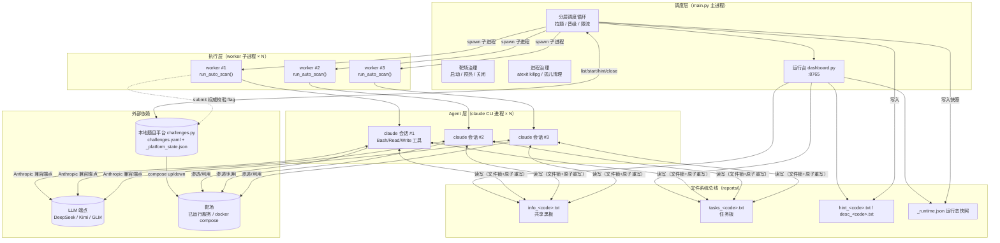
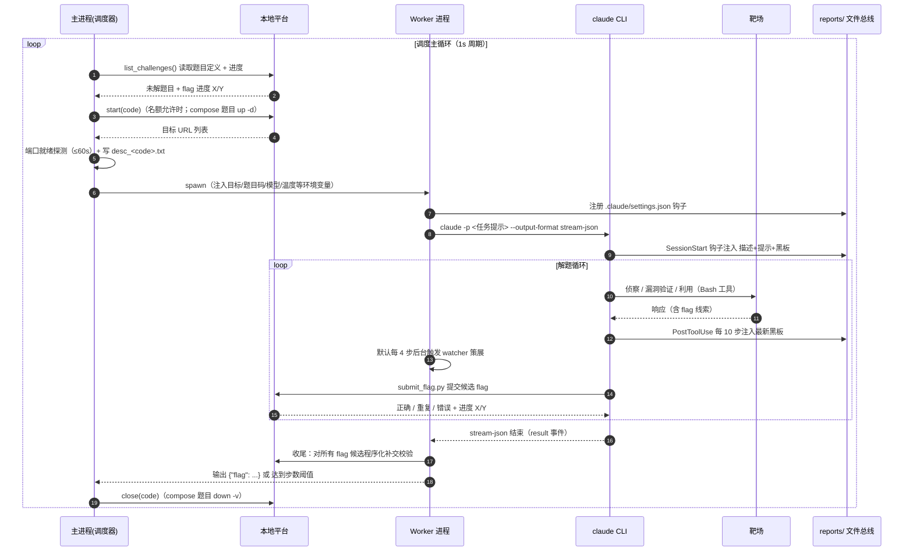
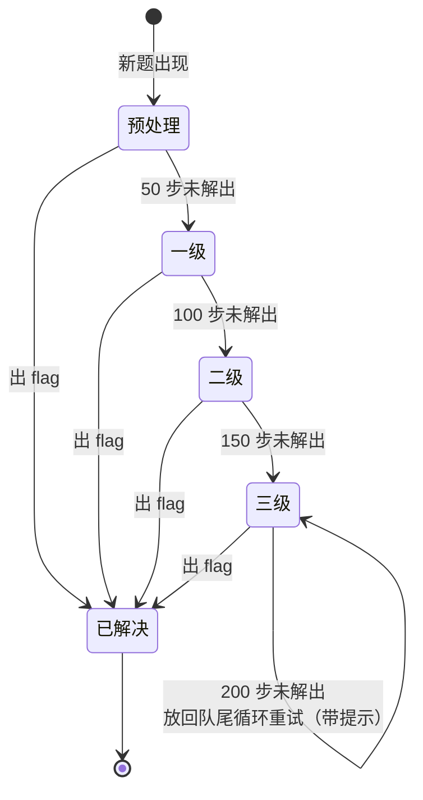
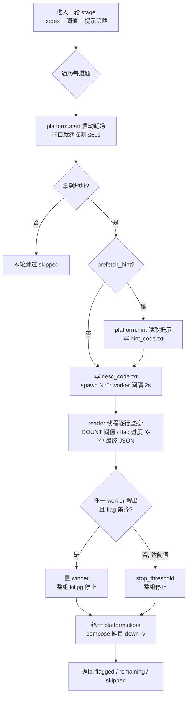
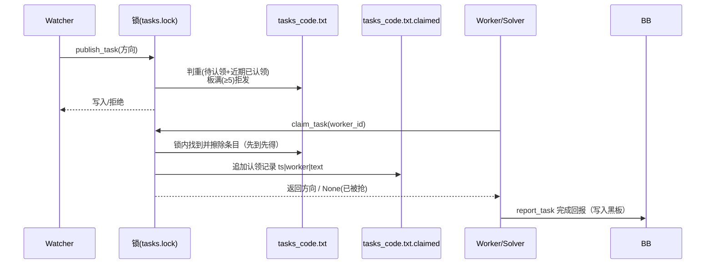
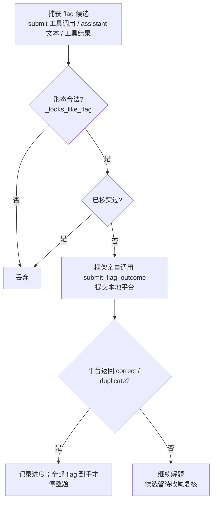
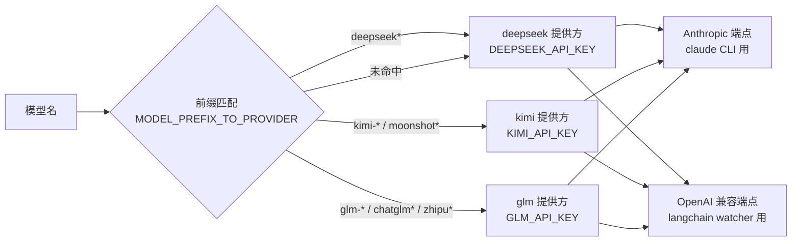

# Cruiser 技术方案文档

> 完全本地运行的自动化 CTF Web/逻辑漏洞挖掘与利用 Agent


| 项目 | 说明 |
|------|------|
| 文档版本 | v1.2 |
| 文档日期 | 2026-10-29 |
| 适用代码基线 | Cruiser 主分支（`main.py` + `cruiser/` 包） |
| 读者对象 | 安全研究人员、Agent 系统开发者、自建 CTF 题库的使用者 |

---

## 目录

1. [概述](#1-概述)
2. [总体架构](#2-总体架构)
3. [核心子系统设计](#3-核心子系统设计)
4. [分层调度机制](#4-分层调度机制)
5. [多会话协作机制](#5-多会话协作机制)
6. [Flag 权威校验与多 Flag 处理](#6-flag-权威校验与多-flag-处理)
7. [LLM 接入与多模型路由](#7-llm-接入与多模型路由)
8. [本地题目平台](#8-本地题目平台)
9. [题目定义格式（YAML）](#9-题目定义格式yaml)
10. [工具链与离线知识库](#10-工具链与离线知识库)
11. [配置体系](#11-配置体系)
12. [并发安全与容错设计](#12-并发安全与容错设计)
13. [可观测性](#13-可观测性)
14. [部署与运行](#14-部署与运行)
15. [性能调优建议](#15-性能调优建议)
16. [风险与限制](#16-风险与限制)
17. [演进方向](#17-演进方向)
18. [附录](#18-附录)

---

## 1. 概述

### 1.1 背景

CTF（Capture The Flag）题目通常以「一个靶场服务 + 一个或多个 flag」的形式出现。Cruiser 把题目、靶场与答案统一写在本地 YAML 文件（`challenges.yaml`）中：靶场既可以是已在运行的服务，也可以是按需拉起的 docker compose 项目；Agent 直连靶场地址完成漏洞挖掘与利用，拿到 flag 后交给本地平台校验。

人工解题无法匹配批量题目的吞吐要求，因此 Cruiser 的设计目标是：**以完全自动化的方式完成「读取题目 → 启动靶场 → 驱动 Agent 解题 → 校验 flag → 关闭靶场」的完整闭环**，并通过多进程并发、分层调度与跨会话共享记忆机制，在本机并发上限约束下最大化解题吞吐与成功率。整个流程不依赖任何外部比赛平台、凭证或 VPN。

### 1.2 设计目标

| 目标 | 说明 | 对应机制 |
|------|------|----------|
| 全自动闭环 | 无需人工干预跑完整个题库 | 主进程调度循环 + 本地题目平台（`cruiser/challenges.py`） |
| 高吞吐 | 并发名额（默认 3）始终打满 | 分层调度 + 动态并行 |
| 高成功率 | 难题多轮尝试、多视角探索 | 四级晋升调度 + 多会话黑板共享 + 提示分级启用 |
| 崩溃可恢复 | 任意一层进程死亡不影响全局 | 三层进程边界 + 进程组回收 + 孤儿清理兜底 |
| 结果可信 | flag 必须由本地平台按题目定义校验，不信任模型自述 | 框架权威校验 + 程序化补交 |
| 解题纪律 | 禁联网检索、尽量不依赖提示 | 禁用 WebSearch/WebFetch + 提示延迟到三级启用 |

### 1.3 设计原则

1. **进程边界清晰**：调度、执行、智能体三层进程各司其职，单层崩溃可独立恢复。
2. **文件系统即总线**：跨进程协作不引入消息队列/数据库，全部通过 `reports/` 目录下的文本文件完成，以 `fcntl` 文件锁 + 临时文件 `os.replace` 原子重写保证并发安全。
3. **不信任模型自述**：flag 有效性、进度完成度均以本地平台（`reports/_platform_state.json`）的校验结果为唯一事实来源。
4. **上下文硬注入**：关键协作信息（题目描述/提示/黑板）通过 Claude Code 钩子物理注入模型上下文，不依赖模型自觉读取文件。
5. **表驱动可扩展**：LLM 提供方接入采用注册表 + 模型名前缀路由，新增一家提供方只需加两行配置。

### 1.4 术语约定

| 术语 | 含义 |
|------|------|
| 题目 / Challenge | 题目定义文件中的一道 CTF 题，有唯一 `code`，可能包含多个 flag |
| 会话 / Session | 一次完整的 `claude` CLI 解题对话 |
| Worker | 执行层子进程（`main.py --sessions 1` 副本），每个 worker 拉起一个 claude 会话 |
| Solver | 定向 worker：只认领任务板上的一条探索方向并聚焦执行 |
| Watcher | 后台策展 LLM：审阅会话活动，维护黑板质量、发布探索方向 |
| 黑板 / Blackboard | 跨会话共享的关键事实文件 `reports/info_<code>.txt` |
| 任务板 / Task Board | 待认领探索方向文件 `reports/tasks_<code>.txt` |
| `[COUNT]` | worker 打印的步数计数（每个 assistant 事件 +1），调度器据此判定层级阈值 |
| turn | claude CLI 的回合数（`--max-turns`），与 `[COUNT]` 不同口径，约为数倍关系 |

---

## 2. 总体架构

### 2.1 三层进程架构

Cruiser 的解题引擎基于 [`claude` CLI](https://docs.anthropic.com/en/docs/claude-code)（`--output-format stream-json` 流式模式）驱动一个自主 Agent，Anthropic 兼容端点默认接入 DeepSeek。系统分为三层进程：



进程链：

```
main.py（调度器）→ main.py --sessions 1（worker）→ claude CLI → bash/python 工具子进程
```

各层职责与崩溃隔离：

| 层 | 进程 | 职责 | 崩溃影响面 |
|----|------|------|------------|
| 调度层 | `main.py` 主进程 | 唯一管理靶场生命周期的进程：轮询未解题目、分层调度、spawn worker、监控 `[COUNT]` 步数、关闭靶场与回收孤儿进程、拉起运行台 | 全局退出，`atexit` 整组清理 worker 并 down 掉 `cruiser_*` compose 项目 |
| 执行层 | worker 子进程（带 `CRUISER_WORKER_ID`） | 调用 `run_auto_scan()`，拉起并解析 claude 流式输出，触发 watcher，权威校验 flag | 单题单会话失败，不影响其他题目 |
| Agent 层 | `claude` CLI 进程 | 真正的解题智能体，用内置 Bash/Read/Write 工具侦察与利用 | 会话结束，worker 收尾后可重启新会话 |

### 2.2 端到端数据流



### 2.3 关键技术选型

| 维度 | 选型 | 理由 |
|------|------|------|
| Agent 运行时 | `claude` CLI（stream-json headless 模式） | 成熟的工具调用循环、上下文压缩、钩子机制；避免自研 ReAct 循环的可靠性问题（旧 `cruiser/agent.py` 手写 ReAct 引擎已弃用保留参考） |
| 解题模型 | DeepSeek（默认 `deepseek-v4-flash`） | 经 Anthropic 兼容端点接入，1M 上下文窗口 |
| 策展模型 | `deepseek-v4-pro` | 黑板策展与方向规划需要更强推理能力 |
| 进程间通信 | 文件系统 + `fcntl` 锁 + `os.replace` | 零外部依赖、崩溃一致性好、可人工检视 |
| 题目平台 | 本地 YAML + `fcntl` 状态文件（`cruiser/challenges.py`） | 无外部依赖；题目/靶场/答案可版本化管理；与黑板同一套文件总线并发模型 |
| 包管理 | uv + `pyproject.toml` | 快速、可锁定（`uv.lock`）；离线镜像整份分发虚拟环境 |

---

## 3. 核心子系统设计

### 3.1 项目结构

```
Cruiser/
├── main.py                  # CLI 入口：题目调度、多会话并发、分层调度、靶场/进程治理、运行台
├── challenges.example.yaml  # 题目定义示例（复制为 challenges.yaml 使用）
├── examples/web-demo/       # 演示靶场（Flask + docker compose）
├── blackboard_hook.py       # Claude Code 钩子：描述/提示/黑板硬注入模型上下文
├── kill_orphans.py          # 悬空 worker/claude 进程清理兜底
├── frontend/                # 运行台静态资源（console.js / console.css / index.html）
├── tools/                   # Agent 调用的 CLI 封装脚本
│   ├── submit_flag.py       # 命令行提交 flag（经本地平台校验）
│   ├── dirsearch_scan.py    # 跨会话去重的目录扫描（同一 URL 只实扫一次）
│   ├── task_board.py        # 探索方向任务板命令行（list/claim/report）
│   └── decompile.py         # PyGhidra 无头反编译 CLI
├── pyproject.toml           # 项目配置与依赖声明
├── cruiser/
│   ├── __init__.py          # 包初始化：禁用 LangSmith 追踪、加载 .env
│   ├── challenges.py        # 本地题目平台：YAML 解析校验、靶场启停、flag 校验与进度
│   ├── claude_agent.py      # 当前解题引擎：claude CLI 驱动 + 黑板 watcher
│   ├── dashboard.py         # 运行台 HTTP：快照 / 黑板 / 任务板 / 日志
│   ├── runtime.py           # 调度器运行态快照（供运行台读取）
│   ├── taskboard.py         # 任务板读写（文件锁 + 原子重写）
│   ├── llm.py               # LLM 提供方注册表与路由（DeepSeek / Kimi / GLM）
│   ├── prompt.py            # 系统提示词与任务模板
│   ├── tools.py             # submit_flag、dirsearch/xss 等工具
│   └── agent.py             # 旧版手写 ReAct 引擎（已弃用，保留供参考）
├── resource/                # 用户名/密码/XSS payload/flag 线索字典
├── kb/                      # 离线漏洞知识库（git submodule：vulhub / nuclei-templates / PayloadsAllTheThings；nuclei 二进制需自行下载）
├── tests/                   # pytest：本地平台、flag 提交、调度器冒烟
├── doc/                     # 本文档
└── reports/                 # 运行时共享黑板 / 任务板 / 提示 / 描述 / 解题进度 / 运行态快照（空目录入库）
```

### 3.2 调度层（`main.py` 主进程）

主进程是系统中**唯一管理靶场生命周期**的进程（worker 仅以 `submit_flag.py` 形式向本地平台做权威校验提交），职责包括：

1. **启动自检**
   - 加载并校验题目定义（`CRUISER_CHALLENGES`，默认 `challenges.yaml`），失败即报错退出；把定义文件的绝对路径写回环境变量，保证 worker 与 Agent 在工作空间内调用的 `submit_flag.py` 读到同一份定义；
   - `down_leftovers()`：对上次异常退出遗留的 `cruiser_*` docker compose 项目执行 `down -v`，确保从干净状态开始（未安装 Docker/compose 时静默跳过）。

2. **调度主循环**（1 秒周期）
   - `fetch_all_unsolved()` 从本地平台读取未解题目及进度；
   - 与内存中的层级队列（`preprocessed / tier1 / tier2 / tier3 / solved`）对账：题目解出（或从定义文件中删除）后不再出现在未解列表，触发对应会话组的强杀（`kill_flags[code].set()`）；
   - 按层级依次尝试启动各题的执行器线程，受 `MAX_INFLIGHT`（`CRUISER_MAX_ACTIVE`，默认 3）严格限流；
   - 全部题目解出且无在飞会话组时，调度器正常退出。

3. **worker 生命周期管理**
   - `spawn_worker()`：以 `main.py --sessions 1 --challenge-code <CODE>` 形式 fork 子进程，注入 `CRUISER_WORKER_ID`（兼作「跳过启动自检」的身份标记）、`CRUISER_WORKSPACE_DIR`、目标地址、模型（`ANTHROPIC_MODEL`）等环境变量；worker 以 `start_new_session` 启动为**独立进程组**。
   - `reader_thread()`：逐行读取 worker 输出，解析 `[COUNT]`，把日志推入运行态；整题是否解出以本地平台的 flag 进度（每 2s 对账一次）为准。
   - 退出清理：`atexit` + SIGINT/SIGTERM 处理器对所有 worker 进程组 `killpg`，并 down 掉所有 `cruiser_*` compose 项目；`kill_orphans.py` 作为父进程意外死亡后的悬空进程兜底清理。

4. **跳过语义**
   - skipped（靶场启动失败、本轮未实际执行）与 remaining（实际执行但未解出）严格区分——skipped 不消耗层级进度，留在原层重试。

### 3.3 执行层（worker 子进程）

worker 是 `main.py` 自身的副本，因带 `CRUISER_WORKER_ID` 而跳过启动自检，直接调用 `cruiser.claude_agent.run_auto_scan()`：

1. 按是否带 `solver_task` 选择系统提示词与任务模板（普通探索 / solver 定向模式）；
2. 在工作空间写入 `.claude/settings.json` 注册黑板钩子（见 §5.2）；
3. 拉起 `claude` CLI 子进程（**不**使用 `start_new_session`，使其留在本进程组内，调度器 `killpg` 时可整组回收）；
4. 逐行解析 stream-json 事件流：
   - `assistant` 事件：`[COUNT]` 步数 +1、提取文本与工具调用、滚动维护最近活动摘要（默认 `deque(maxlen=48)`，`CRUISER_WATCHER_RECENT`）、默认每 4 步（`CRUISER_WATCHER_EVERY`）触发一次后台 watcher、捕获模型提交的 flag 并**当场权威校验**；
   - `user` 事件（工具结果）：正则收集 `flag{...}` 候选，追加观察摘要；
   - `result` 事件：会话结束（success / error_max_turns / error_*），跳出循环；
5. 收尾：会话结束时同步触发一次最终 watcher（30s 超时保护），并对全部 flag 候选逐个程序化补交校验（命中即输出 `[FLAG RECOVERED]`）。

### 3.4 Agent 层（`claude` CLI 进程）

Agent 层的启动命令形态：

```bash
claude -p "<任务提示>" \
  --output-format stream-json --verbose \
  --permission-mode bypassPermissions \
  --append-system-prompt "<系统提示>" \
  --disallowedTools "WebSearch,WebFetch" \
  [--max-turns N]
```

设计要点：

- **禁联网检索**：遵循常见 CTF 规则禁止联网检索，显式从工具集移除 `WebSearch`/`WebFetch`（headless 下 `bypassPermissions` 会自动放行，必须显式禁用）。
- **系统提示词**（`cruiser/prompt.py`）：定位「Web 漏洞 + 逻辑漏洞」解题专家，覆盖 SQL 注入、XSS（目标为弹窗 `XSS` 字符串）、CSRF、文件包含、文件上传、越权、竞态、业务逻辑等类别的识别与利用套路，并内置工程化守则：
  - 批量/并发策略：爆破枚举类任务必须写脚本或用 `seq | xargs -P N` 并发，禁止逐请求手工尝试；
  - 工具纪律：调用安全工具先 `-h/--help`；目录扫描必须走 `dirsearch_scan` 工具（跨会话去重 + 报告落盘，避免上下文溢出）；flag 只能经 `submit_flag` 工具提交；
  - 产物落盘：大输出写入 `$CRUISER_WORKSPACE_DIR` 后再读取筛选，避免撑爆上下文。
- **上下文窗口管理**：通过 `CLAUDE_CODE_MAX_CONTEXT_TOKENS`（默认 1,000,000）声明真实窗口，`CLAUDE_CODE_AUTO_COMPACT_WINDOW`（默认 800,000）提前触发 auto-compact，留余量避免逼近硬上限。

---

## 4. 分层调度机制

### 4.1 层级模型

新题在四个队列间逐级晋升，每级步数阈值递增；任一会话解出 flag 即整组停止。提示（hint）属于额外信息（许多赛事查看提示会扣分），因此**延迟到三级才启用**——先用纯黑盒能力尝试，必要时再借助提示。



| 层级 | 触发条件 | 步数阈值 | 是否带提示 | 未解出去向 |
|------|----------|----------|------------|------------|
| 预处理 | 新题 | 50 | 否 | 晋级一级 |
| 一级 | 预处理未解出 | 100 | 否 | 晋级二级 |
| 二级 | 一级未解出 | 150 | 否 | 晋级三级 |
| 三级 | 二级未解出 | 200 | 是 | 放回队尾，按 200 步循环重试 |

补充规则：

- 一级队列按题目难度排序（`DIFF_RANK`），优先打简单题，快速积累得分；
- **skipped 语义**：靶场启动失败导致本轮根本没执行的题，不算尝试过、不晋级，留在原层等待下一轮；
- 每一级对同一道题并发拉起 `--sessions` 个**黑盒** worker 会话（全程黑盒，无源码审计），各会话独立探索、以不同会话编号署名；
- 所有 worker 均为主力波（wave=2），全部计入步数阈值；阈值判定以**单会话** `[COUNT]` 达到阈值为准。

### 4.2 单轮执行流程（`run_parallel_stage`）



### 4.3 并发名额限流

- 同时在跑的题目数受 `MAX_INFLIGHT = CRUISER_MAX_ACTIVE`（默认 3）约束：每题一组 worker + solver 与一个靶场，限流用于控制本机资源与 LLM 配额；
- 调度循环每轮检查 `_inflight_count() >= MAX_INFLIGHT` 即停止派发新题，剩余题目留待下一轮。

---

## 5. 多会话协作机制

多会话并发的核心矛盾是：**既要独立探索（视角多样性），又要共享发现（避免重复劳动）**。Cruiser 用「共享黑板 + 任务板 + 硬注入钩子 + 策展 watcher」四件套解决。

### 5.1 协作机制总览

```mermaid
flowchart LR
    subgraph 会话侧
        C1[会话 #1] 
        C2[会话 #2]
        C3[会话 #3]
    end

    subgraph 注入通道
        HK["blackboard_hook.py<br/>SessionStart / PostToolUse(每10步)"]
    end

    subgraph 文件总线["reports/（fcntl 锁 + 原子重写）"]
        BB["info_&lt;code&gt;.txt 共享黑板"]
        TB["tasks_&lt;code&gt;.txt 任务板<br/>+ .claimed 认领日志"]
        DK["desc/hint_&lt;code&gt;.txt"]
    end

    subgraph 策展侧
        WA["Watcher LLM (deepseek-v4-pro)<br/>默认每 4 步后台审阅"]
    end

    C1 & C2 & C3 -->|写入发现/任务回报| BB
    WA -->|add/update/remove| BB
    WA -->|publish/retire| TB
    C1 & C2 & C3 -->|claim 认领(先到先得)| TB
    BB & TB & DK --> HK
    HK -->|additionalContext 硬注入| C1 & C2 & C3
    C1 & C2 & C3 -.->|默认每4步活动摘要触发| WA
```

### 5.2 上下文硬注入（`blackboard_hook.py`）

不依赖模型自觉去读黑板文件，而是在 worker 工作目录写入 `.claude/settings.json` 注册 Claude Code 钩子，让内容**物理进入模型上下文**：

| 钩子事件 | 触发时机 | 注入内容 |
|----------|----------|----------|
| `SessionStart` | 会话开局一次 | 题目描述 + 题目提示 + 当前黑板（各若非空） |
| `PostToolUse` | 每 10 次工具调用 | 上述三项的最新内容，并标注「请关注并利用其他会话的新发现」 |

- 注入通道为 `hookSpecificOutput.additionalContext`；
- 单项截断 3000 字符（黑板取**尾部** 3000 字符，保留最新发现），防止上下文被协作信息淹没；
- 钩子按 `CRUISER_CHALLENGE_CODE` 定位该题的文件，无内容可注入时不输出任何东西（零开销）。

### 5.3 共享黑板与策展 Watcher

黑板 `reports/info_<code>.txt` 保存各会话已发现的关键事实（口令、路径、端点、结论等），条目格式：

```
[2026-08-15 12:00:00] 会话: 2
关键信息: /admin 存在越权，无需鉴权可读取用户列表
------------------------------------------------------------
```

**Watcher 策展**（`_watcher_curate_blackboard`）：

- 每个会话默认每 4 步（`CRUISER_WATCHER_EVERY`）在后台线程触发一次（单 watcher 并发闸 `busy` 标志防重入）；会话结束时强制补一次尾部采集（30s join 超时，防止 daemon 线程随进程退出丢失最后发现）；
- watcher LLM（`deepseek-v4-pro`，策展与方向规划需要更强推理）基于：题目描述 + 提示 + 最近活动窗口（默认 48 条，近 12 条保留全文）+ 当前黑板 + 任务板（待认领/执行中），产出结构化 JSON：
  - `add`（≤3 条）：提取新关键信息（普通条目不超过 80 字）；**不写入具体 flag 值，也不新增 `[flag方法]`**；
  - `update`（≤3 条）：修正过时/错误条目（保留原头部的时间戳与会话归属，仅替换信息内容；不改 `[flag方法]`）；
  - `remove`（≤3 条）：删除失效条目（含具体 flag 值的条目一律删；`[flag方法]` 除非漏了 flag 字面量否则不删）；
  - `suggest_tasks`（≤2 条）：向任务板推荐新探索方向；
  - `retire_tasks`（≤3 条）：下架重复/过时方向；
- **并发安全应用变更**：LLM 审阅基于无锁快照；应用变更时持文件锁重读最新内容，按**内容模糊匹配**（归一化包含关系或字符 bigram 重叠系数 ≥ 0.6）定位条目——不用行号，规避并发编辑导致的行号漂移；写回走临时文件 + `os.replace` 原子替换；
- watcher 失败静默吞掉，绝不影响解题主流程；
- 附带职责：从活动与黑板中提取 `flag{...}` 候选并程序化兜底提交——**watcher 也能交 flag**（同一段超过 5 个候选视为爆破输出，不自动交）；
- **`[flag方法]`**：首次提交成功时由该会话分叉写入（漏洞点/请求/步骤，不含 flag 字面量），供其他会话复现剩余 flag；watcher 不增删改。

### 5.4 探索方向任务板（`cruiser/taskboard.py`）

任务板 `reports/tasks_<code>.txt` 用于把「接下来值得试什么」显式化，行格式 `[t-xxxxxx] 方向内容`：



关键参数与规则：

| 项 | 值 | 说明 |
|----|----|------|
| `_MAX_PENDING` | 5 | 板上最多待认领方向数，超过不再发布 |
| `_CLAIMED_TTL_S` | 45 分钟 | 认领擦除后的方向仍参与判重（防 watcher 重复发布）；超时自动解冻，避免认领方异常死亡导致方向永久锁死 |
| 判重算法 | 归一化包含 / bigram ≥ 0.6 | 消除路径分隔符、标点、空白差异的相似方向判定 |
| 认领语义 | 锁内擦除 | 多 worker 并发认领同一方向时只有一个成功 |

### 5.5 Solver 定向执行

除普通探索 worker 外，每题还有一个 `solver_driver` 线程：

- 维持 ≤ `CRUISER_MAX_SOLVERS`（默认 3）个并发 solver；
- 每个 solver 从任务板 **FIFO 认领一条方向**，以聚焦的系统提示词（`CLAUDE_SOLVER_SYSTEM_PROMPT` + 任务模板）启动定向会话，回合上限 `CRUISER_SOLVER_MAX_TURNS`（默认 40），模型 `CRUISER_SOLVER_MODEL`（默认 `deepseek-v4-flash`）；
- solver 退出即回收补位；整题出 flag 或本轮结束时停止并清杀所有 solver；
- 与探索 worker 的关系：探索 worker 广撒网、自然发现并写黑板；watcher 把「值得深挖但未做」的方向显式化到任务板；solver 按需领任务做定向突破，三者形成「探索 → 策展 → 攻坚」的闭环。

---

## 6. Flag 权威校验与多 Flag 处理

### 6.1 权威校验原则

**不信任模型输出的任何文本标记**（包括模型自称「提交成功」），flag 有效性唯一以本地平台的校验结果为准：



- `_verify_flag()` 对同一候选只核实一次（`verified` 集合去重），避免重复提交；返回结构化 `FlagSubmitOutcome`（含 `correct/total`），多 flag 未集齐时会话继续；
- **当场校验**：模型一调用提交工具，框架立即亲自向本地平台核实；
- **收尾补交**：会话结束（出 flag / 达轮数上限 / 自然结束）时，对全部合法候选按长度降序逐个补交——覆盖「flag 在最后一回合找到、提交命令被 `--max-turns` 切断」等情况，命中打印 `[FLAG RECOVERED]`；
- watcher 策展前也先执行一轮候选兜底提交（即便无可用 watcher LLM 也能补交）；
- 同一段文本出现超过 5 个 `flag{...}` 视为爆破/枚举输出，框架不自动提交（模型主动调用 `submit_flag.py` 仍放行）。

### 6.2 多 Flag 题目的完成判定

一道题可能有多个 flag（题目定义的 `flags` 列表长度 > 1），规则：

- `submit_flag` 的回执包含「flag 进度 X/Y」，框架记入 `FlagSubmitOutcome`；
- **仅当已交对数 ≥ flag 总数才判定整题解出**、置 winner 停止整组（调度器以本地平台进度为准，不解析 worker 的最终 JSON）；
- 单会话内未集齐全部 flag 时继续运行，不因交对一枚就结束。

---

## 7. LLM 接入与多模型路由

### 7.1 表驱动提供方注册表（`cruiser/llm.py`）

所有「连哪家模型/端点/用哪把 key」的逻辑集中在 `llm.py`，采用**注册表 + 模型名前缀路由**：



| 提供方 | 密钥环境变量 | 默认端点 | 覆盖变量（Anthropic / OpenAI） |
|--------|--------------|----------|--------------------------------|
| deepseek | `DEEPSEEK_API_KEY` | `https://api.deepseek.com/{anthropic,v1}` | `ANTHROPIC_BASE_URL` / `DEEPSEEK_BASE_URL` |
| kimi (moonshot) | `KIMI_API_KEY` | `https://api.moonshot.cn/{anthropic,v1}` | `KIMI_ANTHROPIC_BASE_URL` / `KIMI_BASE_URL` |
| glm（TokenHub） | `GLM_API_KEY` | `https://tokenhub.tencentmaas.com`（OpenAI 兼容 `/v1`） | `GLM_ANTHROPIC_BASE_URL` / `GLM_BASE_URL` |

端点解析优先级：**显式环境变量覆盖 > 官方默认端点**。新接一家提供方只需在 `PROVIDERS` 注册表加一条配置 + 在 `MODEL_PREFIX_TO_PROVIDER` 加前缀，无需改任何调用方。

### 7.2 双通道消费

| 消费方 | 通道 | 配置来源 |
|--------|------|----------|
| 解题引擎（claude CLI） | Anthropic 兼容端点（`ANTHROPIC_BASE_URL` / `ANTHROPIC_AUTH_TOKEN` / `ANTHROPIC_MODEL`） | `get_claude_provider_env()`，密钥缺失时回退显式 `ANTHROPIC_AUTH_TOKEN` |
| watcher / 旧 ReAct 引擎 | OpenAI 兼容端点（langchain `ChatOpenAI`） | `_build_chat_openai()`，无密钥/依赖时返回 None 静默降级 |

### 7.3 多模型混编与温度分片

- `--worker-models deepseek-v4-flash,deepseek-v4-flash,kimi-k3`：worker 数量 = 清单长度（覆盖 `--sessions`），第 i 个 worker 用第 i 个模型，不同厂商可混搭（按模型名自动路由端点与密钥）；
- 默认模型分工：解题 `deepseek-v4-flash`（`DEEPSEEK_MODEL`/`ANTHROPIC_MODEL` 覆盖）、watcher `deepseek-v4-pro`（`WATCHER_MODEL` 覆盖）、solver `deepseek-v4-flash`（`CRUISER_SOLVER_MODEL` 覆盖）；
- **温度分片**（langchain 路径）：按 worker 编号在 `[CRUISER_TEMP_MIN, CRUISER_TEMP_MAX]`（默认 0.0 ~ 0.9）线性分配——低编号会话确定性高、高编号会话发散性强，用温度梯度制造探索多样性。

---

## 8. 本地题目平台

题目平台由 `cruiser/challenges.py` 实现，进程内单例 `get_platform()`，调度器、worker、solver 与 `tools/submit_flag.py` 各自实例化、经磁盘状态共享进度：

| 操作 | 接口 | 行为 |
|------|------|------|
| 列出题目与进度 | `list_challenges()` | 读题目定义 + 状态文件，返回每题 `correct / total / completed`；调度器 1s 周期轮询，过滤已解题 |
| 启动靶场 | `start(code)` | `target` 题目直接返回地址；`compose` 题目执行 `docker compose -p cruiser_<code> -f <file> up -d`，返回 `addresses`（不带协议头补 `http://`） |
| 关闭靶场 | `close(code)` | `target` 题目为空操作；`compose` 题目执行 `docker compose -p cruiser_<code> -f <file> down -v` |
| 读取提示 | `hint(code)` | 返回题目定义的 `hint`；**三级才调用**，落盘 `hint_<code>.txt` 全会话共享 |
| 提交 flag | `submit(code, flag)` | 明文精确匹配或 `sha256:<hex>` 摘要匹配；返回 `(correct, duplicate, correct_count, total)`；已交对的 flag 再交视为幂等成功 |
| 清理残留 | `down_leftovers()` | `docker compose ls -a` 找出所有 `cruiser_*` 项目并 `down -v`（启动与退出时各一次） |
| 查询进度 | `progress(code)` | 返回 `(已交对数, flag 总数)` |

**跨进程状态**：进度保存在 `reports/_platform_state.json`（`{"challenges": {"<code>": {"solved": [flag 下标...]}}}`），读改写全程持有 `_platform_state.json.lock` 的 `fcntl` 锁，写回走临时文件 + `os.replace` 原子替换；状态文件损坏时备份为 `.corrupt` 后从空状态继续。按下标记录，因此同一 flag 被多个进程并发提交也只计一次。

**题目定义热加载**：按 YAML 文件 mtime 缓存，运行中修改定义文件会自动重新加载。

靶场就绪探测（`CRUISER_CONTAINER_WARMUP`，默认 60s）：拿到地址后主动探测目标端口，可连即拉起会话；**超时也放行**交由 LLM 解题，防止慢启动卡死调度。

命令行：`python -m cruiser.challenges list | reset [CODE…] | down`。

错误处理：

| 错误 | 处理策略 |
|------|----------|
| `ConfigError`（定义文件缺失/格式非法） | 调度器启动即报错退出，指出出错题目与字段 |
| `UnknownChallenge`（题目不在定义中） | 提交返回错误（definitive，不重试） |
| `StartError`（compose up 失败 / 未安装 Docker） | 本轮跳过（skipped），下轮重试 |
| 关闭失败 | 打印 WARN，不阻塞调度；退出时 `down_leftovers()` 兜底 |

---

## 9. 题目定义格式（YAML）

```yaml
challenges:
  - code: WEB-1                  # 必填，形如 <字母数字>-<数字>（Agent 侧按此形态识别 submit_flag.py 调用）
    difficulty: easy             # easy / medium / hard（默认 easy），按 DIFF_RANK 排序
    description: 题目描述          # 写入 desc_<code>.txt，开局经钩子注入
    hint: 可选提示                 # 三级起才下发
    flags:                       # 必填，至少一个
      - flag{plain}              # 明文
      - sha256:<64 位十六进制>     # 摘要（答案不必明文存放）
    target: http://127.0.0.1:8080          # 靶场二选一 ①：已运行服务（字符串或列表）
  - code: WEB-2
    flags: ["flag{x}"]                     # 行内列表中的 flag 含花括号，必须加引号
    compose: web2/docker-compose.yml       # 靶场二选一 ②：相对本 YAML 所在目录
    addresses: ["127.0.0.1:8082"]          # compose 必填：交给 Agent 的地址
```

校验规则：未知字段、重复 `code`、`target` 与 `compose` 同时出现或都缺失、compose 文件不存在、`sha256:` 摘要格式错误等均在加载时报错。示例见 `challenges.example.yaml` 与 `examples/web-demo/`（Flask 路径穿越演示题）。

---

## 10. 工具链与离线知识库

### 10.1 自研 CLI 封装（`tools/`，供 Agent 经 Bash 调用）

| 工具 | 功能 | 设计要点 |
|------|------|----------|
| `submit_flag.py` | 向本地平台提交并校验 flag | flag 提交的唯一通道；回执含进度 X/Y |
| `dirsearch_scan.py` | 目录扫描 | **跨会话去重**：同一 URL 全会话只实扫一次，其余阻塞复用报告；报告落盘防上下文溢出 |
| `task_board.py` | 任务板 `list/claim/report` | Agent 侧的命令行入口 |
| `decompile.py` | PyGhidra 无头反编译 | 输出 C 伪码，并标注被编译器消除的取数、switch 各 case 语义与未确认 opcode、数据引用 |

### 10.2 预装安全工具集

| 类别 | 工具 |
|------|------|
| Web/渗透 | `dirsearch` / `sqlmap` / `fenjing`（SSTI）/ `nuclei`（内置模板库）/ `ffuf` / `whatweb` / Metasploit + PostgreSQL |
| 逆向/Pwn | Ghidra + PyGhidra / `radare2` / `pwntools` / `angr` / `ropper` / `one_gadget` / GDB |
| 密码/取证 | `pycryptodome` / `gmpy2` / `sympy` / `z3` / `steghide` / `zsteg` / `binwalk` |
| 智能合约 | Foundry（`forge`/`cast`/`anvil`）/ 多版本 `solc` / `slither` / `web3.py` |

`list_security_tools` 工具供 Agent 探测环境内可用的安全工具及版本。

### 10.3 离线知识库与字典

- `kb/`：三个 git submodule（[vulhub](https://github.com/vulhub/vulhub) / [nuclei-templates](https://github.com/projectdiscovery/nuclei-templates) / [PayloadsAllTheThings](https://github.com/swisskyrepo/PayloadsAllTheThings)），clone 时加 `--recurse-submodules`；`kb/bin/nuclei` 超过 GitHub 单文件限制，需从 [Releases](https://github.com/projectdiscovery/nuclei/releases) 自行下载。`CRUISER_KB_DIR` 可覆盖路径。配合禁网规则，全部情报来源本地化；
- `resource/`：`username.txt` / `password.txt` / `xss.txt` 字典与 `flag_hunting.txt`（flag 线索清单）。

---

## 11. 配置体系

### 11.1 命令行参数

| 参数 | 默认值 | 说明 |
|------|--------|------|
| `--target` | 无 | 扫描目标地址（未提供时由本地平台启动靶场获取） |
| `--challenge-code` | 无 | 题目代码 |
| `--sessions` | 1 | 并发工作会话数（≥2 进入分层调度） |
| `--worker-models` | 无 | 各 worker 模型清单，覆盖 `--sessions`；`kimi-*` 自动路由 Kimi 端点 |
| `--max-steps` | 0 | 引擎内强制步数上限（0 = 不强制，由调度器按阈值监控） |
| `--hint` | 无 | 题目提示 |
| `--quiet` | False | 静默中间输出，仅保留最终 JSON |
| `--default-timeout` / `--max-timeout` | 0 | `run_command` 默认/上限超时秒数 |

### 11.2 关键环境变量（完整清单见 README）

| 分类 | 变量 | 说明 |
|------|------|------|
| 题目 | `CRUISER_CHALLENGES` | 题目定义 YAML 路径（默认项目根目录 `challenges.yaml`） |
| 密钥 | `DEEPSEEK_API_KEY` / `KIMI_API_KEY` / `GLM_API_KEY` | 按模型名前缀自动选用 |
| 模型 | `CRUISER_MODEL` / `ANTHROPIC_MODEL` / `WATCHER_MODEL` / `CRUISER_SOLVER_MODEL` | 解题 / watcher / solver 模型 |
| 上下文 | `CLAUDE_CODE_MAX_CONTEXT_TOKENS`（1M）/ `CLAUDE_CODE_AUTO_COMPACT_WINDOW`（800K） | 校正 auto-compact 触发时机 |
| 调度 | `CRUISER_MAX_ACTIVE`（3）/ `CRUISER_CONTAINER_WARMUP`（60s） | 并发题目数 / 靶场就绪探测 |
| 协作 | `CRUISER_TEMP_MIN/MAX`（0.0/0.9） | 多会话温度分片区间 |
| watcher | `CRUISER_WATCHER_EVERY`（4）/ `CRUISER_WATCHER_RECENT`（48） | 策展频率与活动窗口 |
| 运行台 | `CRUISER_DASHBOARD` / `CRUISER_DASHBOARD_HOST` / `CRUISER_DASHBOARD_PORT` | 默认 `127.0.0.1:8765`；`=0` 关闭 |
| solver | `CRUISER_SOLVER_MAX_TURNS`（40）/ `CRUISER_MAX_SOLVERS`（3） | solver 回合与并发上限 |
| 逆向 | `GHIDRA_INSTALL_DIR` / `JAVA_HOME` | PyGhidra 运行环境 |

**密钥纪律**：所有凭证一律经环境变量（可写 `.env`，不覆盖已有环境变量），源码零硬编码；`.env` 不入库。

---

## 12. 并发安全与容错设计

### 12.1 并发安全清单

| 场景 | 机制 |
|------|------|
| 黑板/任务板并发读写 | `fcntl.LOCK_EX` 文件锁包裹「读-改-写」全程；写回走临时文件 + `os.replace` 原子替换，读者永远看到完整文件 |
| watcher 应用变更 vs 其他会话写入 | LLM 审阅用无锁快照，应用时锁内重读最新内容，按内容模糊匹配定位（规避行号漂移） |
| 任务认领竞争 | 锁内「找到即擦除」，先到先得；`.claimed` 日志 45 分钟 TTL 参与判重并自动解冻 |
| dirsearch 跨会话重复扫描 | 同一 URL 仅实扫一次，其余会话阻塞等待复用报告 |
| 解题进度并发提交 | `_platform_state.json` 文件锁内读改写 + 按 flag 下标去重，多进程同时交同一 flag 只计一次 |
| flag 重复提交 | 本地平台幂等（duplicate）+ flagstore 预检 + `verified` 集合去重 |

### 12.2 容错与恢复矩阵

| 故障 | 检测 | 恢复 |
|------|------|------|
| worker/claude 崩溃 | reader 线程读到 EOF / 进程退出码 | 该题本轮记 remaining，晋级或重试；其他题不受影响 |
| 主进程退出（Ctrl+C/SIGTERM） | 信号处理器 + `atexit` | 整组 `killpg` 所有 worker 并 down 掉 `cruiser_*` compose 项目 |
| 主进程异常死亡（SIGKILL） | 父进程已死 | `kill_orphans.py` 清理悬空 worker/claude 进程组 |
| compose 靶场残留（主进程被 SIGKILL） | 下次启动 `docker compose ls` | `down_leftovers()` 关闭所有 `cruiser_*` 项目 |
| LLM 端点不可用 | HTTP 异常 | watcher 降级静默跳过；worker 会话自然结束，下轮重试 |
| watcher LLM 失败 | 异常吞没 | 不影响解题主流程；flag 兜底提交先于策展执行 |
| 靶场慢启动 | warmup 探测超时（60s） | 放行交由 LLM 自行重试，防调度卡死 |
| 题目解出 / 从定义文件删除 | 轮询对账 | `kill_flags[code].set()` 强杀对应会话组 |
| 状态文件损坏 | JSON 解析失败 | 备份为 `.corrupt`，从空状态继续 |
| 上下文逼近上限 | `AUTO_COMPACT_WINDOW`（800K） | claude CLI 自动压缩，留 200K 余量 |

---

## 13. 可观测性

调度主进程默认在 `http://127.0.0.1:8765` 拉起运行台（`cruiser/dashboard.py`），展示题目队列、黑板、任务板、flag 进度与 worker 日志。独立进程可用 `uv run python -m cruiser.dashboard`（只读 `reports/`）。`CRUISER_DASHBOARD=0` 关闭。

系统同时通过结构化 stdout 标记输出，便于 `tee` 落盘与 `grep` 检索：

| 标记 | 含义 |
|------|------|
| `[COUNT] N` | 跨会话单调递增的步数计数（调度阈值依据） |
| `[TOOL] ...` / `[Claude] ...` | 工具调用与模型文本摘要 |
| `[Watcher] 会话 X 维护黑板: 新增/修正/删除` | 黑板策展动作 |
| `[Watcher] 会话 X 任务板: 发布/下架` | 任务板变更 |
| `[Stage-Preprocess/Tier1/Tier2/Tier3]` | 层级调度事件 |
| `[STAGE] 步数达到阈值 c/limit` | 本轮停止原因 |
| `[FLAG RECOVERED]` | 会话结束后程序化补交成功 |
| `[Container] ...` / `[Startup] 已关闭遗留靶场` | 靶场治理 |
| `[Fetcher] 全部题目已解出，退出` | 调度器正常结束 |
| `[{code}:S{idx}]` / `[{code}:SOLVER{sid}]` | 按题+会话前缀的 worker/solver 输出 |

---

## 14. 部署与运行

### 14.1 环境要求

- Python ≥ 3.11，[uv](https://docs.astral.sh/uv/) 包管理器；
- **`claude` CLI 必须安装且在 PATH 中**（引擎依赖）；
- 可选：Docker（含 compose 插件），仅 `compose:` 类型题目需要；
- 可选：Ghidra + JDK（PyGhidra 逆向）。

### 14.2 安装与启动

```bash
# 克隆（含 kb/ 三个 submodule）与依赖
git clone --recurse-submodules https://github.com/TJR181/Cruiser-Agent.git
cd Cruiser-Agent
curl -LsSf https://astral.sh/uv/install.sh | sh
uv sync

# 配置凭证（.env 或环境变量）与题目定义
export DEEPSEEK_API_KEY=<DeepSeek 密钥>
cp challenges.example.yaml challenges.yaml   # 按需编辑；或 export CRUISER_CHALLENGES=/path/to/xxx.yaml

# 自动模式：按题目定义分层调度，全部解出后退出（推荐）
uv run python main.py --sessions 5

# 多模型混编
uv run python main.py --worker-models deepseek-v4-flash,deepseek-v4-flash,kimi-k3

# 指定单目标
uv run python main.py --target http://<IP:端口> --challenge-code <CODE>

# 查看/清空解题进度（重跑前）
uv run python -m cruiser.challenges list
uv run python -m cruiser.challenges reset

# 运行测试（stub claude，无需密钥/Docker/网络）
uv run pytest

# 浏览器打开运行台（主进程已拉起时）
# http://127.0.0.1:8765
```

> 离线部署说明：`uv sync` 只装核心依赖，解题中 Agent 还会按需临时加装 Python 包（`web3`/`slither`/`angr` 等）。离线镜像直接整份分发已就绪的 `.venv`，而非在目标环境重新 sync。

---

## 15. 性能调优建议

| 目标 | 手段 |
|------|------|
| 提高单位时间解题数 | 调大 `--sessions`（受本机资源与 LLM 配额约束）；按机器能力调整 `CRUISER_MAX_ACTIVE` |
| 提高难题成功率 | 提高三级阈值；`--worker-models` 混入更强模型（如 1 个 `deepseek-v4-pro` 带 2 个 flash）；确认 watcher 用 pro 级模型 |
| 降低 token 成本 | 主力用 flash 级模型；黑板/任务板注入已有 3000 字符截断；`--quiet` 减少日志 I/O |
| 减少重复劳动 | 保持黑板注入开启；dirsearch 去重勿绕过；合理温度分片（默认 0.0~0.9）保证视角差异 |
| 缩短靶场空转 | warmup 探测保持默认 60s；compose 题目尽量精简镜像、加快服务启动 |

---

## 16. 风险与限制

1. **强依赖 `claude` CLI**：引擎构建在其 stream-json 协议与钩子机制上，CLI 版本升级需回归验证。
2. **本机资源约束**：compose 靶场与多会话 worker 都跑在本机，`CRUISER_MAX_ACTIVE` 过大会导致资源争用；compose 题目的 `addresses` 端口需自行避免冲突。
3. **提示策略**：三级起才下发提示，属设计取舍（先黑盒、再借助提示）；不希望 Agent 看到提示时不写 `hint` 即可。
4. **黑盒定位**：当前流程全程黑盒（无源码审计通道）；对需源码辅助的题目依赖 Agent 自行从靶场读源码（文件包含/命令执行后优先读源码已写入提示词）。
5. **watcher 成本**：默认每 4 步一次 pro 级模型调用，token 开销随会话数线性增长（可用 `CRUISER_WATCHER_EVERY` 调稀）。
6. **文件总线规模**：单题黑板依赖 watcher 策展控制体量；极端长会话下黑板仍可能膨胀，注入端以尾部 3000 字符截断兜底。

---

## 17. 演进方向

| 方向 | 说明 |
|------|------|
| 解题画像学习 | 统计各题型的层级分布与耗时，动态调整阈值与模型搭配 |
| 黑板结构化升级 | 从自由文本演进为「端点/凭证/漏洞/结论」分类条目，支持按类检索注入 |
| solver 策略强化 | 根据任务板认领完成率动态扩缩 solver 数；引入方向优先级 |
| 多题知识迁移 | 跨题目沉淀可复用利用模式（当前知识库为静态离线 PoC） |
| 恢复点能力 | 会话中断后基于黑板 + 活动摘要续跑，而非从零开始 |
| 评测报表 | 运行台已覆盖实时队列/黑板/日志；可再汇总每题步数与 token 消耗 |

---

## 18. 附录

### 18.1 关键源文件索引

| 文件 | 职责 |
|------|------|
| `main.py` | CLI 入口、靶场治理、分层调度主循环、worker/solver 生命周期、运行台 |
| `cruiser/challenges.py` | 本地题目平台：YAML 解析校验、靶场启停、flag 校验、跨进程进度、命令行 |
| `cruiser/claude_agent.py` | claude CLI 驱动、stream-json 解析、watcher 策展、flag 权威校验、`[flag方法]` 写入 |
| `cruiser/dashboard.py` | 运行台 HTTP 服务 |
| `cruiser/runtime.py` | 调度器运行态快照与 `reports/` 汇编 |
| `cruiser/llm.py` | LLM 提供方注册表、模型路由、温度分片 |
| `cruiser/taskboard.py` | 任务板发布/认领/回报/下架（文件锁 + 原子重写 + 相似度判重） |
| `cruiser/prompt.py` | 系统提示词与任务模板（探索 / solver 两套） |
| `cruiser/tools.py` | submit_flag、dirsearch、XSS fuzz 等工具实现 |
| `blackboard_hook.py` | SessionStart / PostToolUse 上下文硬注入钩子 |
| `kill_orphans.py` | 悬空进程清理兜底 |
| `challenges.example.yaml` / `examples/web-demo/` | 题目定义示例与演示靶场 |
| `tests/` | pytest 测试（含 stub claude 的调度器冒烟测试） |

### 18.2 运行时文件布局（`reports/`）

| 文件 | 内容 | 写者 | 读者 |
|------|------|------|------|
| `info_<code>.txt` | 共享黑板 | 各会话 / watcher / 任务回报 | 钩子注入、watcher |
| `tasks_<code>.txt` | 待认领探索方向 | watcher | worker / solver |
| `tasks_<code>.txt.claimed` | 认领日志（45min TTL） | claim_task | publish 判重、watcher |
| `hint_<code>.txt` | 题目提示 | 主进程（三级拉取） | 钩子注入、watcher |
| `desc_<code>.txt` | 题目描述 | 主进程 | 钩子注入、watcher |
| `_runtime.json` | 调度器运行态快照 | 主进程 | 运行台（独立进程模式） |
| `_flagstore.json` | 跨进程正确/错误 flag 记忆 | submit_flag | 提交预检、前缀学习 |
| `_platform_state.json` | 本地平台解题进度（每题已交对的 flag 下标） | 本地平台 `submit` | 调度器对账、提交回执进度、`python -m cruiser.challenges list` |

---

*本文档与代码同步维护；机制性变更请同步修订对应章节。*
